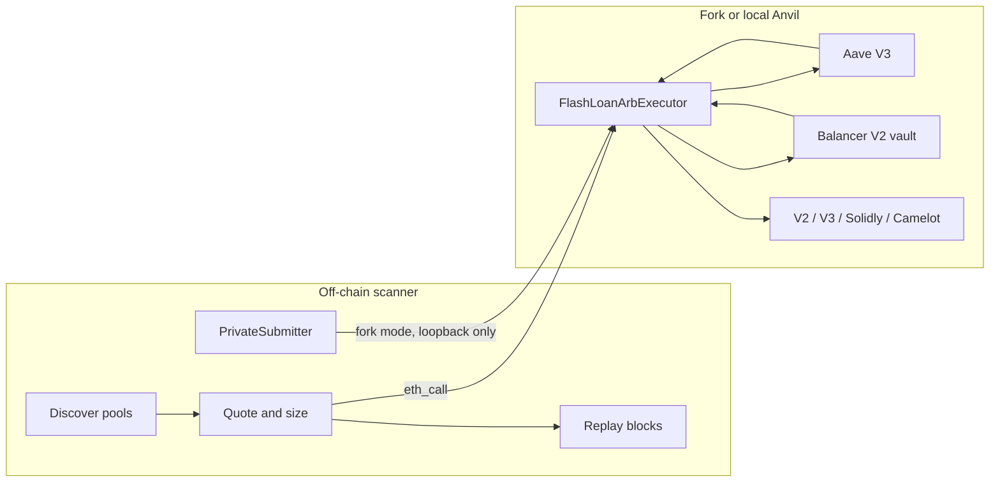

# flashloan-arb-sim

Simulation only. This repository does not broadcast to Ethereum, Base, or Arbitrum unless you deliberately arm live mode, which is not recommended. The default `ARB_MODE` is `simulate`: the bot builds a private-orderflow payload and stops. Fork mode delivers that transaction to a loopback Anvil and nowhere else.

The on-chain piece is an owner-only, non-upgradeable executor. It borrows with an Aave V3 flash loan or a Balancer V2 flash loan (fee zero), swaps across two pools, and reverts unless the balance covers the premium and `minProfit`. Gas is not visible on-chain. The bot folds a gas cushion into the off-chain profit check.

The question this repo actually answers is whether a naive two-pool search still finds money in places searchers supposedly ignore: Base and Arbitrum, and long-tail pools with low TVL. The historical scan below says no, not above gas, in the windows that were measured.

## Architecture



`FlashLoanArbExecutor` is not a proxy, has no `delegatecall`, and has no owner-transfer function. `owner` is immutable. `nonReentrant` runs across the flash callback. A concentrated-liquidity callback clears the active pool before it pays the token, so a malicious token cannot be paid twice. The contract trusts the owner to pick pools. It does not trust pools or tokens.

Routes are explicit. `DexKind` covers Uniswap V2-style pairs (Uniswap V2, Sushi, BaseSwap), Uniswap V3, Solidly volatile and stable (Aerodrome / Velodrome), Camelot V2 volatile, and Camelot stable. Slipstream is quoted off-chain only when QuoterV2 agrees; the executor treats a passing Slipstream pool as a Uniswap V3 swap because that pool uses the same callback.

## Niches this bot looks at

Head WETH/USDC books on mainnet are a control, not the target. The configured set is:

- Base: Aerodrome volatile and stable, Aerodrome Slipstream, Uniswap V3, Sushi, BaseSwap. Flash from Aave V3 (`0xA238…d1c5`) or Balancer.
- Arbitrum: Camelot V2 (volatile and stable), Sushi, Uniswap V3. Native USDC books are mostly dust; USDC.e is the quote that actually has inventory. Flash from Aave V3 (`0x794a…14aD`) or Balancer.
- A pool is long-tail when both legs sit between $2k and $100k. Cross-tier means one long-tail leg and one head leg (at least $500k). Under $2k is dust and is not counted. V3 “TVL” is active liquidity at the current tick, not deposited TVL.

## Private order flow

`PrivateSubmitter` builds the payload a searcher would post, then refuses to post it unless live mode is armed.

| Chain | Payload | What it does not do |
| --- | --- | --- |
| Mainnet | `eth_sendPrivateTransaction` to `https://rpc.flashbots.net` (Flashbots Protect) | It does not reserve state. Another bundle can still land first. |
| Base | `eth_sendRawTransaction` to `https://mainnet-sequencer.base.org` | Base has no public mempool and no Flashbots bundles. This is a latency race. |
| Arbitrum | `eth_sendRawTransaction` to `https://arb1.arbitrum.io/rpc` | Ordering is the sequencer. Priority is Timeboost, not a private bundle. |

Modes:

- `simulate` (default). Payload is built and returned. Nothing is sent.
- `fork`. The payload is recorded, then `send_raw` is called only if `FORK_RPC_URL` is `127.0.0.1`, `localhost`, or `::1`. The Flashbots and sequencer URLs are not contacted.
- `live`. Requires `ARB_MODE=live` and `ARB_ALLOW_LIVE=i-understand-live-trading-is-not-recommended`. Not recommended. There is no key in this repo. Do not put one in a commit.

## Run it from a phone

GitHub Codespaces uses `.devcontainer`. The image installs Foundry and, on create, a Python venv plus `forge build`. Forwarded port 8545 is for Anvil.

```bash
make test          # forge unit tests + pytest. No RPC, no broadcast.
make test-fork     # pinned forks. Skips a chain when the node no longer has that block.
make analyze       # read-only competition scan. Writes analysis/latest.json.
make anvil-demo    # local fork only. Submits to 127.0.0.1.
```

Copy `.env.example` to `.env` if you want different RPCs. Public endpoints are the default. Never commit `.env` or a funded key. The Anvil demo uses Anvil’s published default account, and only after the URL is confirmed to be loopback.

Fork tests are pinned in `config/fork-blocks.json` (mainnet `26252880`, Base `52969900`, Arbitrum `517431000`). Override with `FORK_BLOCK_MAINNET`, `FORK_BLOCK_BASE`, `FORK_BLOCK_ARBITRUM`. CI uses the same public RPCs and exits 0 when a node returns a prune, archive, or rate-limit error. An assertion failure still fails the job. Unit tests always run.

## Historical competition

The scanner replays `Sync` and Uniswap V3 `Swap` logs. An opportunity opens when one transaction moves a two-pool cycle from not profitable to profitable after DEX fees, the flash premium, and a gas cushion. The cushion is `gas_units * max(base fee at the two ends of the window) * WETH price`, plus $0.03 on Base and $0.08 on Arbitrum for L1 calldata / Timeboost. It is captured only when a later transaction in the same block or the next block touches both pools and the profit goes to zero or below. If the spread dies without such a transaction, the result is ambiguous, not “a bot got it.” If it is still profitable at the end of the next block, it is uncaptured and counted once. Edges above 25% are dropped as suspect (tax tokens, broken decimals). Spreads already open at the first block are not counted until they reset; anything still profitable at the last block is reported as a standing residual. There were none.

Quotes are checked against the chain at the start block before a pool can enter the headline. Camelot stable is the Solidly invariant after a fee over 1e5, not constant product. Solidly and Camelot pools that miss `getAmountOut` by more than 0.5% are dropped. Uniswap V3 quotes more than 1% above QuoterV2 are dropped. A within-tick V3 quote that is below QuoterV2 is kept as a lower bound. Slipstream pools QuoterV2 cannot price are dropped. Replay that does not match the chain at the end block drops that pool (one pool on Base, three on Arbitrum, none on mainnet).

WETH was about $2,400 from the deepest WETH/stable pool. USDC, USDT, DAI, USDbC, and USDC.e are pegged at $1 in this table. Balancer’s flash fee is zero when the vault holds at least the $25k flash cap (WETH and USDC on Base; WETH, USDC.e, USDT, WBTC, DAI, and RDNT on Arbitrum; WETH, USDC, DAI, USDT, WBTC, AAVE, and LDO on mainnet). Every other token pays Aave’s 5 bps.

These windows are short. They are not an annualised PnL.

| Chain | Blocks | Tier | Opportunities | Captured same block | Captured next block | Ambiguous | Uncaptured | Uncaptured net USD after gas | Notes |
| --- | --- | --- | ---: | ---: | ---: | ---: | ---: | ---: | --- |
| base | 52970045–52971845 | long_tail | 0 | 0 | 0 | 0 | 0 | 0.00 | base fee 0.0050 gwei; WETH $2407.22; suspect excluded 0; replay mismatches 1; max spot edge 380.46 bps; fee-only evals 11750 (cleared fees and premium, not the gas cushion) |
| base | 52970045–52971845 | cross_tier | 0 | 0 | 0 | 0 | 0 | 0.00 |  |
| base | 52970045–52971845 | head | 2 | 0 | 0 | 2 | 0 | 0.00 |  |
| base | 52970045–52971845 | mid | 1 | 0 | 0 | 1 | 0 | 0.00 |  |
| arbitrum | 517443647–517447647 | long_tail | 0 | 0 | 0 | 0 | 0 | 0.00 | base fee 0.0200 gwei; WETH $2398.11; suspect excluded 0; replay mismatches 3; max spot edge 113.45 bps; fee-only evals 290 (cleared fees and premium, not the gas cushion) |
| arbitrum | 517443647–517447647 | cross_tier | 0 | 0 | 0 | 0 | 0 | 0.00 |  |
| arbitrum | 517443647–517447647 | head | 0 | 0 | 0 | 0 | 0 | 0.00 |  |
| mainnet | 26253231–26253311 | long_tail | 0 | 0 | 0 | 0 | 0 | 0.00 | base fee 0.0440 gwei; WETH $2399.47; suspect excluded 0; replay mismatches 0; max spot edge 527.18 bps; fee-only evals 70 (cleared fees and premium, not the gas cushion) |
| mainnet | 26253231–26253311 | cross_tier | 0 | 0 | 0 | 0 | 0 | 0.00 |  |
| mainnet | 26253231–26253311 | head | 14 | 4 | 2 | 8 | 0 | 0.00 |  |
| mainnet | 26253231–26253311 | mid | 2 | 0 | 0 | 2 | 0 | 0.00 |  |

Source: `analysis/latest.json`, produced by `python -m flasharb.analyze` against public RPCs. The first Base window (900 blocks) and the first Arbitrum window (2000 blocks) were empty after gas, so each was widened once.

### What the numbers say

Uncaptured net profit after gas is **$0.00** on every chain and every tier, including long-tail and cross-tier. Nothing that cleared fees, the flash premium, and the gas cushion was still profitable at the end of the next block. There was also no standing residual at the end of any window.

On mainnet, in 80 blocks, the head set produced 14 dislocations that did clear gas. Six were closed by a later transaction that touched both pools: four in the same block, two in the next. Those six had about **$14.49** of model profit at the moment they opened (that is the size of the dislocation, not cash a searcher banked). The other eight were ambiguous: the spread was gone one block later, but no single later transaction touched both pools, so this replay will not call them captures. Two mid-tier dislocations were also ambiguous. Zero stayed open.

Base, across 1800 blocks, produced three dislocations that cleared gas (two head, one mid). All three were ambiguous. None were an atomic two-pool backrun that this replay could see, and none were left behind. Arbitrum, across 4000 blocks, produced zero dislocations that cleared gas at any tier.

The scanner was not blind to smaller gaps. A fee-only evaluation is a moment where the spot gap cleared both DEX fees and the flash premium and the sized trade was profitable before the gas cushion. Base recorded 11750 of those, Arbitrum 290, mainnet 70. The widest spot gap was 380 bps on Base, 113 bps on Arbitrum, and 527 bps on mainnet, all under the 25% suspect cutoff. On a thin pool a 3% gap is often only a few cents after impact. The gas cushions in these windows were about $0.04 on Base ($0.03 L1 plus a 0.005 gwei base fee), about $0.11 on Arbitrum ($0.08 Timeboost/L1 plus a 0.02 gwei base fee), and about $0.05 on mainnet (0.044 gwei, no extra L1 line). The long-tail gaps did not clear that hurdle.

That is why a naive bot loses. The dislocations large enough to pay mainnet gas in the head books were taken in the same block or the next one. The long-tail gaps that were still sitting there were smaller than gas, which is a different way of saying they were not a trade. Private order flow does not change the arithmetic: Flashbots Protect hides a mainnet transaction from the public mempool and does not reserve the state, Base submission is a race to the sequencer, and Arbitrum priority is Timeboost. A bot that sends the public way, or the private way, still arrives after the searcher who already closed the spread, and still pays gas on a residual that does not cover gas.

Two limits belong next to the table. Log replay at transaction boundaries misses reverted attempts and misses bundles that never hit the public log stream as two separate swaps. A V3 quote that stops at the current tick is a lower bound, so some real V3 profit is missing from the count rather than invented. Eighty mainnet blocks and a few thousand L2 blocks are a sample, not a career.

## Crafted fork tests

Unit tests do not need a node. Fork tests fork the pinned block, dump WETH into the thinner pool, and require the executor to keep a profit and then to revert on a round trip, a non-owner, and an impossible `amountOutMin`. Measured profits from those tests, when the pinned state was still available:

| Fork | Route | Profit |
| --- | --- | --- |
| Mainnet 26252880 | Aave, Uni V2 / Sushi after dumping a quarter of Sushi’s WETH | 0.0275 WETH |
| Mainnet 26252880 | Aave, Uni V3 0.05% / Sushi, same dump | 0.0276 WETH |
| Mainnet 26252880 | Balancer, Uni V2 / Sushi, smaller dump | 0.0215 WETH |
| Base 52969900 | Aave, Aerodrome volatile / BaseSwap, dump a quarter of BaseSwap WETH | 0.0266 WETH |
| Base 52969900 | Balancer, same pair, smaller dump | 0.0207 WETH |
| Arbitrum 517431000 | Aave, Sushi / Camelot, dump a quarter of Camelot’s WETH against USDC.e | 0.0274 WETH |

The Balancer rows are smaller because the test stops at the first size that works, not because the zero premium made the trade worse. These are manufactured prices on a fork. They show the executor repays and keeps a surplus. They are not the historical result above.

## Layout

- `src/FlashLoanArbExecutor.sol` — borrow, swap, repay, `minProfit`
- `src/libraries/V2Math.sol`, `SafeTransfer.sol` — constant-product math and transfers that bubble the inner revert
- `test/` — unit tests and mocks. `test/fork/Fork.t.sol` — pinned forks
- `bot/flasharb/` — quotes, sizing, competition accounting, private submitter, read-only scan
- `config/chains/` — tokens, factories, TVL bands, gas units
- `analysis/latest.json` — the table above

## What I learned

