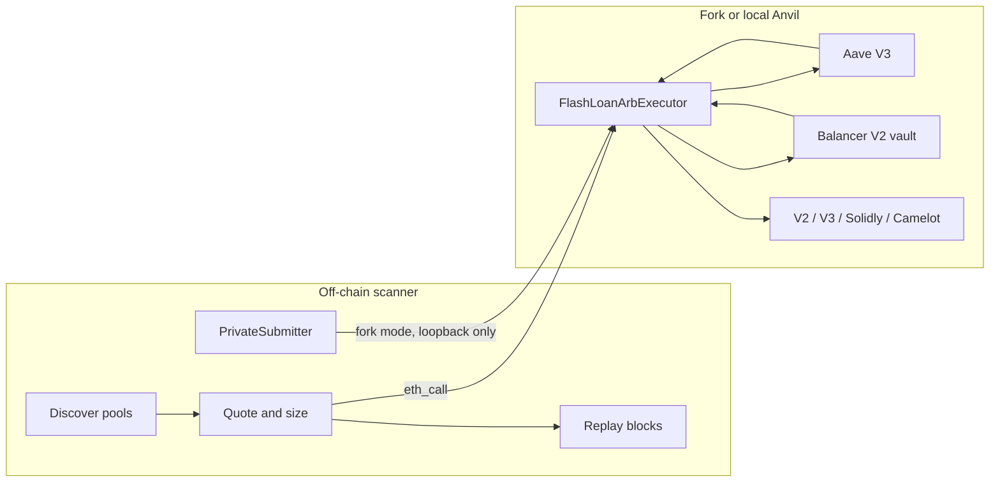

# flashloan-arb-sim

Simulation only. This repository does not broadcast to Ethereum, Base, or Arbitrum unless you deliberately arm live mode, which is not recommended. The default `ARB_MODE` is `simulate`: the bot builds a private-orderflow payload and stops. Fork mode delivers that transaction to a loopback Anvil and nowhere else.

The on-chain piece is an owner-only, non-upgradeable executor. It borrows with an Aave V3 flash loan or a Balancer V2 flash loan (fee zero), swaps across two pools, and reverts unless the balance covers the premium and `minProfit`. Gas is not visible on-chain. The bot folds a gas cushion into the off-chain profit check.

The question this repo actually answers is whether a naive two-pool search still finds money in places searchers supposedly ignore: Base and Arbitrum, and long-tail pools with low TVL. The historical scan below says no, not above gas, in the windows that were measured.

## Architecture



`FlashLoanArbExecutor` is not a proxy, has no `delegatecall`, and has no owner-transfer function. `owner` is immutable. `nonReentrant` runs across the flash callback. A concentrated-liquidity callback clears the active pool before it pays the token, so a malicious token cannot be paid twice. The contract trusts the owner to pick pools. It does not trust pools or tokens.

Routes are explicit. `DexKind` covers Uniswap V2-style pairs (Uniswap V2, Sushi, BaseSwap), Uniswap V3, Solidly volatile and stable (Aerodrome / Velodrome), Camelot V2 volatile, and Camelot stable. Slipstream is quoted off-chain only when QuoterV2 agrees; the executor treats a passing Slipstream pool as a Uniswap V3 swap because that pool uses the same callback.

## Niches this bot looks at

Head WETH/USDC books on mainnet are a control, not the target. The configured set is:

- Base: Aerodrome volatile and stable, Aerodrome Slipstream, Uniswap V3, Sushi, BaseSwap. Flash from Aave V3 (`0xA238…d1c5`) or Balancer.
- Arbitrum: Camelot V2 (volatile and stable), Sushi, Uniswap V3. Native USDC books are mostly dust; USDC.e is the quote that actually has inventory. Flash from Aave V3 (`0x794a…14aD`) or Balancer.
- A pool is long-tail when both legs sit between $2k and $100k. Cross-tier means one long-tail leg and one head leg (at least $500k). Under $2k is dust and is not counted. V3 “TVL” is active liquidity at the current tick, not deposited TVL.

## Private order flow

`PrivateSubmitter` builds the payload a searcher would post, then refuses to post it unless live mode is armed.

| Chain | Payload | What it does not do |
| --- | --- | --- |
| Mainnet | `eth_sendPrivateTransaction` to `https://rpc.flashbots.net` (Flashbots Protect) | It does not reserve state. Another bundle can still land first. |
| Base | `eth_sendRawTransaction` to `https://mainnet-sequencer.base.org` | Base has no public mempool and no Flashbots bundles. This is a latency race. |
| Arbitrum | `eth_sendRawTransaction` to `https://arb1.arbitrum.io/rpc` | Ordering is the sequencer. Priority is Timeboost, not a private bundle. |

Modes:

- `simulate` (default). Payload is built and returned. Nothing is sent.
- `fork`. The payload is recorded, then `send_raw` is called only if `FORK_RPC_URL` is `127.0.0.1`, `localhost`, or `::1`. The Flashbots and sequencer URLs are not contacted.
- `live`. Requires `ARB_MODE=live` and `ARB_ALLOW_LIVE=i-understand-live-trading-is-not-recommended`. Not recommended. There is no key in this repo. Do not put one in a commit.

## Run it from a phone

GitHub Codespaces uses `.devcontainer`. The image installs Foundry and, on create, a Python venv plus `forge build`. Forwarded port 8545 is for Anvil.

```bash
make test          # forge unit tests + pytest. No RPC, no broadcast.
make test-fork     # pinned forks. Skips a chain when the node no longer has that block.
make analyze       # read-only competition scan. Writes analysis/latest.json.
make liquidations  # read-only liquidation study. Writes analysis/liquidations.json.
make headline      # $5,000 overlooked-market backfill. Adds headline_5k to that file and leaves the rest.
make mempool       # read-only mempool log, about 20 minutes. Writes analysis/mempool.json.
make anvil-demo    # local fork only. Submits to 127.0.0.1.
```

Copy `.env.example` to `.env` if you want different RPCs. Public endpoints are the default. Never commit `.env` or a funded key. The Anvil demo uses Anvil’s published default account, and only after the URL is confirmed to be loopback.

Fork tests are pinned in `config/fork-blocks.json` (mainnet `26252880`, Base `52969900`, Arbitrum `517431000`). Override with `FORK_BLOCK_MAINNET`, `FORK_BLOCK_BASE`, `FORK_BLOCK_ARBITRUM`. CI uses the same public RPCs and exits 0 when a node returns a prune, archive, or rate-limit error. An assertion failure still fails the job. Unit tests always run.

## Historical competition

The scanner replays `Sync` and Uniswap V3 `Swap` logs. An opportunity opens when one transaction moves a two-pool cycle from not profitable to profitable after DEX fees, the flash premium, and a gas cushion. The cushion is `gas_units * max(base fee at the two ends of the window) * WETH price`, plus $0.03 on Base and $0.08 on Arbitrum for L1 calldata / Timeboost. It is captured only when a later transaction in the same block or the next block touches both pools and the profit goes to zero or below. If the spread dies without such a transaction, the result is ambiguous, not “a bot got it.” If it is still profitable at the end of the next block, it is uncaptured and counted once. Edges above 25% are dropped as suspect (tax tokens, broken decimals). Spreads already open at the first block are not counted until they reset; anything still profitable at the last block is reported as a standing residual. There were none.

Quotes are checked against the chain at the start block before a pool can enter the headline. Camelot stable is the Solidly invariant after a fee over 1e5, not constant product. Solidly and Camelot pools that miss `getAmountOut` by more than 0.5% are dropped. Uniswap V3 quotes more than 1% above QuoterV2 are dropped. A within-tick V3 quote that is below QuoterV2 is kept as a lower bound. Slipstream pools QuoterV2 cannot price are dropped. Replay that does not match the chain at the end block drops that pool (one pool on Base, three on Arbitrum, none on mainnet).

WETH was about $2,400 from the deepest WETH/stable pool. USDC, USDT, DAI, USDbC, and USDC.e are pegged at $1 in this table. Balancer’s flash fee is zero when the vault holds at least the $25k flash cap (WETH and USDC on Base; WETH, USDC.e, USDT, WBTC, DAI, and RDNT on Arbitrum; WETH, USDC, DAI, USDT, WBTC, AAVE, and LDO on mainnet). Every other token pays Aave’s 5 bps.

These windows are short. They are not an annualised PnL.

| Chain | Blocks | Tier | Opportunities | Captured same block | Captured next block | Ambiguous | Uncaptured | Uncaptured net USD after gas | Notes |
| --- | --- | --- | ---: | ---: | ---: | ---: | ---: | ---: | --- |
| base | 52970045–52971845 | long_tail | 0 | 0 | 0 | 0 | 0 | 0.00 | base fee 0.0050 gwei; WETH $2407.22; suspect excluded 0; replay mismatches 1; max spot edge 380.46 bps; fee-only evals 11750 (cleared fees and premium, not the gas cushion) |
| base | 52970045–52971845 | cross_tier | 0 | 0 | 0 | 0 | 0 | 0.00 |  |
| base | 52970045–52971845 | head | 2 | 0 | 0 | 2 | 0 | 0.00 |  |
| base | 52970045–52971845 | mid | 1 | 0 | 0 | 1 | 0 | 0.00 |  |
| arbitrum | 517443647–517447647 | long_tail | 0 | 0 | 0 | 0 | 0 | 0.00 | base fee 0.0200 gwei; WETH $2398.11; suspect excluded 0; replay mismatches 3; max spot edge 113.45 bps; fee-only evals 290 (cleared fees and premium, not the gas cushion) |
| arbitrum | 517443647–517447647 | cross_tier | 0 | 0 | 0 | 0 | 0 | 0.00 |  |
| arbitrum | 517443647–517447647 | head | 0 | 0 | 0 | 0 | 0 | 0.00 |  |
| mainnet | 26253231–26253311 | long_tail | 0 | 0 | 0 | 0 | 0 | 0.00 | base fee 0.0440 gwei; WETH $2399.47; suspect excluded 0; replay mismatches 0; max spot edge 527.18 bps; fee-only evals 70 (cleared fees and premium, not the gas cushion) |
| mainnet | 26253231–26253311 | cross_tier | 0 | 0 | 0 | 0 | 0 | 0.00 |  |
| mainnet | 26253231–26253311 | head | 14 | 4 | 2 | 8 | 0 | 0.00 |  |
| mainnet | 26253231–26253311 | mid | 2 | 0 | 0 | 2 | 0 | 0.00 |  |

Source: `analysis/latest.json`, produced by `python -m flasharb.analyze` against public RPCs. The first Base window (900 blocks) and the first Arbitrum window (2000 blocks) were empty after gas, so each was widened once.

### What the numbers say

Uncaptured net profit after gas is **$0.00** on every chain and every tier, including long-tail and cross-tier. Nothing that cleared fees, the flash premium, and the gas cushion was still profitable at the end of the next block. There was also no standing residual at the end of any window.

On mainnet, in 80 blocks, the head set produced 14 dislocations that did clear gas. Six were closed by a later transaction that touched both pools: four in the same block, two in the next. Those six had about **$14.49** of model profit at the moment they opened (that is the size of the dislocation, not cash a searcher banked). The other eight were ambiguous: the spread was gone one block later, but no single later transaction touched both pools, so this replay will not call them captures. Two mid-tier dislocations were also ambiguous. Zero stayed open.

Base, across 1800 blocks, produced three dislocations that cleared gas (two head, one mid). All three were ambiguous. None were an atomic two-pool backrun that this replay could see, and none were left behind. Arbitrum, across 4000 blocks, produced zero dislocations that cleared gas at any tier.

The scanner was not blind to smaller gaps. A fee-only evaluation is a moment where the spot gap cleared both DEX fees and the flash premium and the sized trade was profitable before the gas cushion. Base recorded 11750 of those, Arbitrum 290, mainnet 70. The widest spot gap was 380 bps on Base, 113 bps on Arbitrum, and 527 bps on mainnet, all under the 25% suspect cutoff. On a thin pool a 3% gap is often only a few cents after impact. The gas cushions in these windows were about $0.04 on Base ($0.03 L1 plus a 0.005 gwei base fee), about $0.11 on Arbitrum ($0.08 Timeboost/L1 plus a 0.02 gwei base fee), and about $0.05 on mainnet (0.044 gwei, no extra L1 line). The long-tail gaps did not clear that hurdle.

That is why a naive bot loses. The dislocations large enough to pay mainnet gas in the head books were taken in the same block or the next one. The long-tail gaps that were still sitting there were smaller than gas, which is a different way of saying they were not a trade. Private order flow does not change the arithmetic: Flashbots Protect hides a mainnet transaction from the public mempool and does not reserve the state, Base submission is a race to the sequencer, and Arbitrum priority is Timeboost. A bot that sends the public way, or the private way, still arrives after the searcher who already closed the spread, and still pays gas on a residual that does not cover gas.

Two limits belong next to the table. Log replay at transaction boundaries misses reverted attempts and misses bundles that never hit the public log stream as two separate swaps. A V3 quote that stops at the current tick is a lower bound, so some real V3 profit is missing from the count rather than invented. Eighty mainnet blocks and a few thousand L2 blocks are a sample, not a career.

## Crafted fork tests

Unit tests do not need a node. Fork tests fork the pinned block, dump WETH into the thinner pool, and require the executor to keep a profit and then to revert on a round trip, a non-owner, and an impossible `amountOutMin`. Measured profits from those tests, when the pinned state was still available:

| Fork | Route | Profit |
| --- | --- | --- |
| Mainnet 26252880 | Aave, Uni V2 / Sushi after dumping a quarter of Sushi’s WETH | 0.0275 WETH |
| Mainnet 26252880 | Aave, Uni V3 0.05% / Sushi, same dump | 0.0276 WETH |
| Mainnet 26252880 | Balancer, Uni V2 / Sushi, smaller dump | 0.0215 WETH |
| Base 52969900 | Aave, Aerodrome volatile / BaseSwap, dump a quarter of BaseSwap WETH | 0.0266 WETH |
| Base 52969900 | Balancer, same pair, smaller dump | 0.0207 WETH |
| Arbitrum 517431000 | Aave, Sushi / Camelot, dump a quarter of Camelot’s WETH against USDC.e | 0.0274 WETH |

The Balancer rows are smaller because the test stops at the first size that works, not because the zero premium made the trade worse. These are manufactured prices on a fork. They show the executor repays and keeps a surplus. They are not the historical result above.

## Flash-loan liquidations

Same rules as the arb scan. Nothing in this path broadcasts. Morpho and Euler numbers below are from their public APIs for 25 July 2026 17:59 UTC through 23 October 2026 17:59 UTC. Delay, gas, and the open-book quotes are archive `eth_call`s and receipts. Where a field could not be read, it is left out of the sum. Every liquidation is still in `loan_sizes`. The section under this one is only the loans of at least $5,000 in the overlooked markets.

### Loans of at least $5,000

Overlooked, fixed before this count, means Euler v2 on every chain, Morpho Blue on Base only when current supply is under $500,000 (`long_tail` or `mid`), Morpho Blue on Arbitrum (isolated, whatever the current tier), Moonwell, Seamless, the Fluid liquidator on Base `0x8f5455245e74a2ea60a32751654a57b1aae4be99`, and one Silo liquidation contract on Arbitrum `0x20deb7395f88a18af2eb51a0c3053f15c1781933`. Head Morpho books and mainnet Morpho stay in the log and are not this headline. A Morpho Base market whose current supply was not read is `supply_unknown`, not small. The tier is current supply, not supply on the liquidation day. A missing price is not treated as under $5,000.

Of the 4,505 Morpho and Euler liquidations already logged, 383 have a priced repay of at least $5,000. Eight of those are in this headline (4 Euler, 4 small Base Morpho). The other 375 are mainnet Morpho, or Base Morpho whose current tier is not `long_tail` or `mid`. Zero Base rows of this size were `supply_unknown`. The backfill then added Moonwell, Seamless, Fluid, Silo, and Arbitrum Morpho. The headline is 16 events. Source: `headline_5k` in `analysis/liquidations.json`, written 2026-10-23T20:32:41Z. `make headline` does not replace the rest of that file.

| Market | Chain | Liquidations | Repaid sum | Median delay | Liquidators | Quoted net |
| --- | --- | ---: | ---: | --- | ---: | --- |
| Morpho RSS/USDC, long-tail `0x1293c4e7…` | Base | 1 | 3,005,223.07 | 0 blocks / 0s | 1 | −3,005,221.79 |
| Moonwell AERO `0x73902f61…` | Base | 6 | 65,361.93 | not measured | 4 | not quoted |
| Euler XAUt/USDC `0x797DD806…` | mainnet | 1 | 27,661.04 | 0 blocks / 0s | 1 | −13,266.56 |
| Morpho stkWELL/USDC, long-tail `0xb3920b96…` | Base | 2 | 26,148.90 | 3,729.5 blocks / 7,459s | 1 | not quoted |
| Euler USDC/WETH `0xD8b27CF3…` | mainnet | 1 | 16,007.13 | 1 block / 12s | 1 | −2,347.56 |
| Euler sUSDf/USDC `0x3573A84B…` | mainnet | 1 | 8,478.51 | 1,132 blocks / 13,620s | 1 | not quoted |
| Morpho yoUSD/USDC, mid `0x1a3e69d0…` | Base | 1 | 7,289.74 | 0 blocks / 0s | 1 | not quoted |
| Moonwell USDC `0xedc817a2…` | Base | 1 | 5,731.44 | not measured | 1 | not quoted |
| Moonwell WETH `0x628ff693…` | Base | 1 | 5,618.98 | not measured | 1 | not quoted |
| Euler mFARM/USDC `0x6f2598c9…` | mainnet | 1 | 5,107.73 | 2,566 blocks / 30,900s | 1 | not quoted |

Morpho Arbitrum, Seamless, Fluid, and Silo do not appear in that table. Their counts are below. Thirteen addresses landed the 16 events. Only the Moonwell AERO market had more than one. A single liquidator means one address landed the transaction. Failed attempts are not in the log.

Delay was measured on the 8 Morpho and Euler rows, not on Moonwell. Three were still healthy at the end of the previous block (delay 0): RSS/USDC, XAUt/USDC, and yoUSD/USDC. Two were already liquidatable one block earlier: stkWELL/USDC at 1 Base block / 2 seconds (`0x156714ef…`, repay $18,177.44) and USDC/WETH at 1 mainnet block / 12 seconds. Three sat longer than five blocks, and longer than an hour: stkWELL/USDC again at 7,458 blocks / 14,916 seconds (`0x83a641e3…`, repay $7,971.46, same liquidator `0x8407699e…`), sUSDf/USDC at 1,132 blocks / 13,620 seconds, and mFARM/USDC at 2,566 blocks / 30,900 seconds. None of the 8 was still unread at the 7-day censor.

The slippage quote is a direct Uniswap v2, Solidly, or Uniswap v3 quote of the seized collateral into the loan token at the previous block. The winner’s own swap is not in that state. Slipstream was not searched. USD is the daily loan-token mark. Gas is the winner’s receipt, including that transaction’s route, not a bare liquidate. The flash fee is zero only when the Morpho or Balancer balance at that quote block covers the repay. Three rows produced a net. All three are negative, and all three were delay 0 or 1.

| Liquidation | Delay | DEX out | Gas | Flash fee | Net |
| --- | --- | ---: | ---: | ---: | ---: |
| RSS/USDC, tx `0x2c8a9255…`, block 52358356 | 0 | 1.29 | 0.003 | 0 | −3,005,221.79 |
| XAUt/USDC, tx `0x5fbf427b…`, block 26255932 | 0 | 14,395.08 | 0.59 | 0 | −13,266.56 |
| USDC/WETH, tx `0x82c7bd24…`, block 25791662 | 1 block / 12s | 13,659.76 | 0.19 | 0 | −2,347.56 |

RSS repaid $3,005,223.07 and the direct pool returned $1.29 of USDC. That is an empty book, not a decimal bug. XAUt’s daily seized mark is $27,858.04 and the pool returned $14,395.08 against a $27,661.04 repay. USDC seized against WETH marked $16,154.34 and the pool returned $13,659.76 against a $16,007.13 repay. Gas is not what makes these negative.

The three that sat for hours had no direct v2, Solidly, or v3 pool, so net is unmeasured. sUSDf seized marked $8,491.00 against an $8,478.51 repay, and mFARM seized marked $5,108.87 against a $5,107.73 repay. Those marks are not a fill. stkWELL is the same sit already in the delay section, where the daily-mark bonus was $1,710.70. Slipstream and any other venue were not searched. Zero quoted rows were both slow and profitable. Nothing in this set was shown left untaken long enough for a slower newcomer to take a profit after gas and a real slippage quote.

Moonwell is the 21 markets `getAllMarkets` returned. Publicnode served Base logs back to block 51038012 (head 52998011), about 45.37 days, with 0 gaps. The walk stopped at block 50998012. The 90-day start was block 49106513, so about 44.7 days of Base logs were not scanned. A stop is not zero events. Inside the readable window Moonwell had 671 `LiquidateBorrow` logs and all 671 have a debt price. Eight are at least $5,000. The AERO market’s underlying is `0x940181a9…` (AERO in `config/chains/base.json`): six repays, sum $65,361.93, average $10,893.66, median $6,704.50, four liquidators (`0x0d9d7517…`, `0x3623c921…`, `0x605560b8…`, `0xddcd62f4…`). The largest is $32,392.89 in tx `0x35545110…`, block 51670276. USDC `0xedc817a2…` is one repay of $5,731.44 (tx `0xfbb6b1ea…`). WETH `0x628ff693…` is one repay of $5,618.98 (tx `0x153a287d…`). `seizeTokens` is an mToken amount, so seized USD and the swap were not computed. Delay was not searched. Some winner receipts are large ($46.30, $247.55, $278.80) because they are the whole transaction.

Seamless, on the same Base window, returned 0 events and 0 gaps. The Fluid liquidator returned 0 logs. Neither is a 90-day claim.

Silo on that one Arbitrum contract was scanned for blocks 486499743–517631735, about 90.08 days at 0.25 seconds a block, with 0 gaps. Six `LiquidationCall` logs, all one market `0xfc1AC64e…`, one borrower `0xf1F38783…`, one liquidator `0x1A7F0B52…`. The log does not carry token addresses. Repaid raw runs from about 2.77e19 to 4.53e19 and seized raw from about 8.1e7 to 1.1e8. USD was not computed, and these six are not counted as under $5,000.

Arbitrum Morpho, same 90-day API window as mainnet and Base, returned 80 liquidations. None entered the headline. A read of the Morpho daily series prices all 80. The largest is $811.90, 811.946577 USDC of thBILL collateral in tx `0xccb96dcc…`, block 488148833, that day’s USDC mark $0.999939789. One repay is 0.00023084538773554 WETH. Five repay USDT0 (`0xFd086bC7…`, 6 decimals). The largest of those is $37.22 (37.25894 tokens, tx `0xc184e2c0…`). The other four are $11.68, $3.91, $3.71, and $0.96.

The open book is a fresh indexer pull of health factor at or below 1 on mainnet, Base, and Arbitrum. Forty Arbitrum Morpho positions have a debt mark of at least $5,000. Zero Base positions do. None of the forty had collateral of at least 30% of debt and debt of at most $2 million, so none were read on chain and none were quoted. Thirty-one are K/USDC head with no collateral mark or a debt mark above $2 million (the largest mark is $14,494,340,989.02). Six are RLP/USDC head whose collateral mark is under 30% of debt; the largest is $1,681,693.88 of debt against $3,301.23 of collateral. One xUSD/USDC mark is $169,306,889.55 and one GVLT/USDC mark is $76,006,853.93, both with no collateral mark. The one long-tail row is wstUSR/USDC `0x06a5954e…` at $9,817.29, also with no collateral mark. These are not sitting profits. Euler’s open dollar book was not measured.

No $5,000-or-larger loan in these overlooked markets was shown left untaken long enough for a slower newcomer. The three exits that could be quoted were taken in the same block or the next one, and the quote lost money after gas. The three that sat for hours had no direct pool, so that profit was not measured. Moonwell’s eight large repays have no delay and no seize quote. Seamless and Fluid were empty only in the 45 days Base still serves. Silo’s six logs have no USD. Arbitrum Morpho’s quarter never reached $5,000. The open indexer rows were not confirmed unhealthy on chain.

### What was liquidated

| Source | Events | Priced | Positive paper bonus USD | Window |
| --- | ---: | ---: | ---: | --- |
| Morpho Blue, mainnet + Base | 4406 | 4080 | 1,351,043.21 | 90 days |
| Euler v2, mainnet + Base + Arbitrum | 99 | 99 | 506.12 | 90 days |
| Moonwell, Base | 142 | 132 repaid, bonus not priced | repaid 315.80, bonus unknown | 2 days, blocks 52908363–52994763 |
| Seamless, Base | 0 |  |  | same 2 days, scan completed |
| Fluid Vault T1 liquidator on Base `0x8f5455245e74a2ea60a32751654a57b1aae4be99` | 0 logs |  |  | 14 days, blocks 52389963–52994763 |
| Silo, one Arbitrum contract `0x20deb7395f88a18af2eb51a0c3053f15c1781933` | 0 |  |  | 2 days, blocks 516917727–517608927 |

Morpho’s paper bonus is seized collateral times that day’s Morpho USD price, minus repaid debt at the loan token’s daily price. It is not cash. The median positive Morpho bonus is $5.06. Nineteen events over $10,000, all on mainnet, are $1,174,891 of the $1,351,043. The largest is PT-reUSD-10DEC2026 / USDC in block 25829882: the daily mark says $346,905.66 of bonus on a $13.01 million repay. The oracle price in that block says the bonus was 340,440.82 USDC. Those two marks agree within about two percent, so the size is not a decimal bug. Selling thirteen million dollars of that principal token was not quoted. 326 Morpho events have no daily price. 267 of those are Base AFAKE.

Euler’s $506.12 is `bonusUsd` from `https://v3.euler.finance/v3/liquidations`, valued from their historical price snapshots.

Moonwell is every `LiquidateBorrow` on the 21 markets `getAllMarkets` returned, one market per request. The repaid USD uses the underlying token and the Morpho price when one exists. `seizeTokens` is an mToken amount, so the bonus is unknown. One address, `0x16e41af5e034113802d06064fbeb020cc3d47b19`, sent 130 of the 142. Seamless, Fluid, and that Silo contract were scanned cleanly and were empty in those short windows. That is not a 90-day claim, and it is not a claim about every Silo or every Fluid vault.

### Loan size

Loan size is the debt, in USD. On an observed liquidation it is the debt repaid in that event, which can be a partial repayment of a larger loan. This table does not rebuild the borrower's balance before the transaction. Collateral seized is a separate mark and is not the loan size. Morpho USD uses that day's Morpho price. Euler USD uses the Euler API's historical snapshot, so the two averages are not one methodology. A missing price is counted and left out of the average. Every priced and unpriced row is in `analysis/liquidations.json` under `loan_sizes`.

Morpho priced the debt on 4,397 of 4,406 liquidations and the seized collateral on 4,087. The nine missing debt prices and the 319 missing collateral prices are omitted from those columns. Base AFAKE is in the debt column and not in the seized column: the loan token had a daily price and the collateral token did not. Euler priced both sides on all 99 events.

| Set | Rows | Debt priced | Average debt | Median debt | Collateral priced | Average collateral | Median collateral |
| --- | ---: | ---: | ---: | ---: | ---: | ---: | ---: |
| Morpho liquidations, debt repaid / collateral seized | 4406 | 4397 | 12,122.55 | 64.58 | 4087 | 12,318.72 | 75.34 |
| Euler liquidations, debt repaid / collateral seized | 99 | 99 | 779.11 | 8.17 | 99 | 784.18 | 8.79 |

Morpho debt repaid, priced events only: 2,434 under $100, 1,109 from $100 to $1k, 593 from $1k to $10k, 221 from $10k to $100k, 34 from $100k to $1m, and 6 of at least $1m. Euler: 74 under $100, 14 from $100 to $1k, 9 from $1k to $10k, 2 from $10k to $100k, and none larger.

The Morpho average is not a typical liquidation. Six repays of at least $1 million account for $36,030,499.12. The other 4,391 priced Morpho liquidations average $3,933.58, and their median is $64.31, next to $64.58 on the full priced set. The largest is still PT-reUSD-10DEC2026 / USDC in block 25829882: $13,009,396.31 repaid and $13,356,301.97 of collateral seized on the daily mark. Euler's largest repay is $27,661.04 and its largest seize is $27,858.04. No Euler liquidation in this window reached $100,000.

The same bucket cut, per Morpho market and per Euler vault. Debt buckets are priced rows only, in the order under $100 / $100–$1k / $1k–$10k / $10k–$100k / $100k–$1m / at least $1m. The market id prefix separates pools that share a symbol. One Euler vault has no collateral symbol in the price feed and is labeled unknown.

| Chain | Market | N | Debt priced | Avg debt | Median debt | Collateral priced | Avg seized | Median seized | Debt buckets |
| --- | --- | ---: | ---: | ---: | ---: | ---: | ---: | ---: | --- |
| base | cbXRP/USDC `0xd4a903dc` | 1580 | 1580 | 3,146.13 | 194.97 | 1580 | 2,948.07 | 195.88 | 614/573/275/112/6/0 |
| base | WETH/USDC `0x8793cf30` | 492 | 492 | 3,779.58 | 83.88 | 492 | 3,032.25 | 69.08 | 255/109/95/30/3/0 |
| base | cbETH/USDC `0x0ca10126` | 416 | 416 | 944.13 | 25.85 | 416 | 777.27 | 21.27 | 300/80/30/5/1/0 |
| base | AFAKE/WETH `0xde70aae6` | 267 | 267 | 19.46 | 19.56 | 0 | — | — | 267/0/0/0/0/0 |
| base | JitoSOL/USDC `0x09276541` | 224 | 224 | 709.97 | 43.44 | 224 | 566.96 | 33.44 | 147/62/12/3/0/0 |
| base | SOL/USDC `0x7dc02ff6` | 218 | 218 | 2,509.53 | 100.55 | 218 | 2,017.80 | 79.27 | 109/51/46/12/0/0 |
| base | cbDOGE/USDC `0x73527ddd` | 206 | 206 | 1,165.58 | 57.45 | 206 | 1,139.39 | 55.94 | 121/51/29/5/0/0 |
| base | cbADA/USDC `0xd7520ad1` | 132 | 132 | 1,722.89 | 118.99 | 132 | 1,491.78 | 108.75 | 63/40/21/8/0/0 |
| base | cbLTC/USDC `0x9125d0fa` | 81 | 81 | 5,515.34 | 39.50 | 81 | 4,727.32 | 33.60 | 54/18/2/6/1/0 |
| base | cbZEC/USDC `0xe458a501` | 59 | 59 | 1,393.01 | 88.79 | 59 | 1,149.58 | 80.82 | 31/21/5/2/0/0 |
| base | USDC/WETH `0x3b3769cf` | 51 | 51 | 38.13 | 1.16 | 51 | 48.38 | 1.62 | 45/6/0/0/0/0 |
| base | stkWELL/USDC `0xb3920b96` | 49 | 49 | 792.10 | 25.64 | 49 | 943.14 | 36.21 | 33/11/4/1/0/0 |
| mainnet | sNUSD/USDC `0xae60b71b` | 46 | 46 | 39,889.05 | 1,249.09 | 46 | 40,803.64 | 1,277.72 | 10/10/16/7/3/0 |
| base | cbBTC/USDC `0x9103c3b4` | 37 | 37 | 2,224.19 | 3.18 | 37 | 2,296.58 | 2.77 | 25/6/5/1/0/0 |
| base | wbCOIN/USDC `0x34f676bd` | 35 | 35 | 1.71 | 0.4025 | 35 | 1.84 | 0.4041 | 35/0/0/0/0/0 |
| base | stEUR/jEUR `0x4f55f2f1` | 23 | 23 | 19.24 | 8.66 | 23 | 25.71 | 11.58 | 23/0/0/0/0/0 |
| mainnet | FXRP/RLUSD `0x4fa31e3f` | 18 | 18 | 814.93 | 734.96 | 18 | 671.04 | 646.59 | 6/6/6/0/0/0 |
| mainnet | PT-reUSD-10DEC2026/USDT `0x6acd1885` | 17 | 17 | 56,180.47 | 11,930.92 | 17 | 58,501.26 | 12,479.53 | 3/3/1/5/5/0 |
| mainnet | PT-reUSD-10DEC2026/USDC `0x1e9d6146` | 16 | 16 | 2,199,135.06 | 379,137.02 | 16 | 2,259,959.28 | 390,298.21 | 0/1/1/4/6/4 |
| mainnet | WETH/USDC `0x94b823e6` | 16 | 16 | 4,999.95 | 13.07 | 16 | 4,131.14 | 12.62 | 10/4/0/2/0/0 |
| mainnet | stNXM/wNXM `0x8126619a` | 14 | 14 | 1,681.25 | 2,198.16 | 0 | — | — | 2/3/9/0/0/0 |
| mainnet | USDC/USDf `0x412D0E31` | 13 | 13 | 298.53 | 10.66 | 13 | 299.82 | 10.87 | 9/2/2/0/0/0 |
| mainnet | stakedao-FrxMsUSD/frxUSD `0x328aadb8` | 13 | 13 | 156,836.26 | 102,732.16 | 13 | 171,318.81 | 114,112.83 | 1/0/0/4/7/1 |
| mainnet | USDf/USDC `0x3573A84B` | 12 | 12 | 841.62 | 10.38 | 12 | 843.15 | 10.64 | 8/3/1/0/0/0 |
| mainnet | PT-cUSD-23JUL2026/USDC `0x702b7ec7` | 12 | 12 | 1.80 | 0.9075 | 12 | 1.84 | 0.9312 | 12/0/0/0/0/0 |
| mainnet | beraSTONE/WETH `0xf78b7d3a` | 12 | 12 | 153.46 | 22.44 | 12 | 199.36 | 29.15 | 10/1/1/0/0/0 |
| base | mBASIS/USDC `0x45f3b568` | 10 | 10 | 157.90 | 40.65 | 10 | 164.07 | 41.77 | 6/4/0/0/0/0 |
| mainnet | ynETHx/msETH `0xd2630c0e` | 9 | 9 | 6,689.26 | 2,786.21 | 9 | 6,900.30 | 2,872.96 | 2/1/4/2/0/0 |
| base | wstETH/WETH `0x3a4048c6` | 8 | 8 | 0.0019 | 0.0009 | 8 | 0.0019 | 0.0009 | 8/0/0/0/0/0 |
| base | AERO/USDC `0xdaa04f68` | 8 | 8 | 43.85 | 26.99 | 8 | 25.54 | 16.01 | 7/1/0/0/0/0 |
| mainnet | PT-srUSDe-15JAN2026/USDC `0x79b4e55c` | 8 | 8 | 1,383.41 | 539.28 | 8 | 1,419.45 | 553.33 | 2/3/3/0/0/0 |
| mainnet | apyUSD/USDC `0x9c28c8fa` | 8 | 8 | 40,970.18 | 223.97 | 8 | 38,959.65 | 212.37 | 3/2/0/2/1/0 |
| mainnet | srRoyUSDC/USDC `0xacc49fbf` | 8 | 8 | 365.81 | 220.00 | 8 | 372.65 | 224.82 | 2/5/1/0/0/0 |
| base | USDC/WETH `0x859160DB` | 7 | 7 | 2.18 | 0.2006 | 7 | 2.19 | 0.2058 | 7/0/0/0/0/0 |
| mainnet | unknown/WETH `0x45c3B59d` | 7 | 7 | 122.79 | 100.76 | 7 | 130.96 | 110.39 | 3/4/0/0/0/0 |
| base | cbETH/USDC `0x1c21c59d` | 7 | 7 | 1,568.35 | 48.75 | 7 | 1,260.55 | 39.40 | 4/1/2/0/0/0 |
| base | cbHYPE/USDC `0x76629002` | 7 | 7 | 420.02 | 111.99 | 7 | 507.73 | 135.81 | 3/3/1/0/0/0 |
| mainnet | ezETH/WETH `0xD8b27CF3` | 6 | 6 | 2,672.99 | 2.29 | 6 | 2,697.61 | 2.30 | 5/0/0/1/0/0 |
| base | stUSD/jEUR `0x995caf62` | 6 | 6 | 8.86 | 7.11 | 0 | — | — | 6/0/0/0/0/0 |
| base | cUSDO/USDC `0x99f294c4` | 6 | 6 | 2.96 | 2.47 | 6 | 3.03 | 2.52 | 6/0/0/0/0/0 |
| mainnet | USD0USD0++/USDC `0x864c9b82` | 6 | 6 | 43.72 | 9.10 | 6 | 44.92 | 9.35 | 5/1/0/0/0/0 |
| mainnet | PEPE/USDC `0xde2bb822` | 6 | 6 | 3.46 | 1.82 | 6 | 2.93 | 1.85 | 6/0/0/0/0/0 |
| base | reUSD/USDC `0x4C1aeda9` | 5 | 5 | 229.07 | 11.14 | 5 | 230.01 | 11.24 | 4/0/1/0/0/0 |
| base | USDC/AERO `0x5Fe2DE3E` | 5 | 5 | 323.61 | 0.5205 | 5 | 324.20 | 0.5247 | 4/0/1/0/0/0 |
| mainnet | USDC/wstETH `0xbC4B4AC4` | 5 | 5 | 16.87 | 11.29 | 5 | 17.43 | 11.35 | 5/0/0/0/0/0 |
| base | KTA/USDC `0x6b526941` | 5 | 5 | 1,388.50 | 781.14 | 5 | 2,836.56 | 1,585.70 | 2/1/2/0/0/0 |
| base | METAc/USDC `0xa8835b56` | 5 | 5 | 0.3410 | 0.2042 | 5 | 0.4195 | 0.1733 | 5/0/0/0/0/0 |
| mainnet | PT-stcUSD-29JAN2026/USDC `0x03f715ef` | 5 | 5 | 795.36 | 168.35 | 5 | 816.19 | 172.76 | 2/2/1/0/0/0 |
| base | yoUSD/USDC `0x1a3e69d0` | 4 | 4 | 1,915.86 | 171.97 | 4 | 1,951.64 | 174.70 | 2/1/1/0/0/0 |
| base | WMTX/USDC `0x85bafa41` | 4 | 4 | 609.59 | 64.73 | 4 | 1,191.98 | 95.63 | 2/1/1/0/0/0 |
| mainnet | USDT/JPYR `0x1f719d50` | 4 | 0 | — | — | 4 | 6.00 | 4.54 | 0/0/0/0/0/0 |
| mainnet | PT-sNUSD-5MAR2026/USDC `0x2a9a5c43` | 4 | 4 | 35.32 | 23.38 | 0 | — | — | 4/0/0/0/0/0 |
| mainnet | cbBTC/USDC `0x64d65c9a` | 4 | 4 | 590.96 | 585.40 | 4 | 545.52 | 594.00 | 1/2/1/0/0/0 |
| mainnet | wsrUSD/USDT `0xa9f70093` | 4 | 4 | 73.95 | 66.65 | 4 | 74.81 | 67.18 | 2/2/0/0/0/0 |
| mainnet | PAXG/PYUSD `0xeea9a243` | 4 | 4 | 32.18 | 9.32 | 4 | 34.00 | 10.20 | 3/1/0/0/0/0 |
| arbitrum | PT-USDai-20NOV2025/USDC `0x6aFB8d3F` | 3 | 3 | 50.04 | 49.28 | 3 | 50.68 | 49.71 | 3/0/0/0/0/0 |
| base | USDC/AERO `0x9F876520` | 3 | 3 | 1,477.72 | 780.92 | 3 | 1,482.38 | 784.25 | 1/1/1/0/0/0 |
| base | VVV/WETH `0xC64FD613` | 3 | 3 | 304.66 | 1.10 | 3 | 303.78 | 1.10 | 2/1/0/0/0/0 |
| base | CLAWNCH/USDC `0x308c06f5` | 3 | 3 | 0.0005 | 1.50e-05 | 3 | 0.0015 | 1.15e-05 | 3/0/0/0/0/0 |
| base | sAMM-USDC/cUSDO/USDC `0x5b347b3d` | 3 | 3 | 0.4906 | 0.6015 | 0 | — | — | 3/0/0/0/0/0 |
| base | WETH/WETH `0x9197544a` | 3 | 3 | 2.24 | 2.24 | 3 | 3.19 | 3.22 | 3/0/0/0/0/0 |
| base | cbBTC/USDC `0xec8f7036` | 3 | 3 | 10.00 | 10.00 | 3 | 8.95 | 8.95 | 3/0/0/0/0/0 |
| base | cbXRP/USDC `0xfdfecf85` | 3 | 3 | 3.13 | 0.0101 | 3 | 2.62 | 0.0089 | 3/0/0/0/0/0 |
| base | USR/USDC `0xff0f2bd5` | 3 | 3 | 2.41 | 2.29 | 3 | 0.4114 | 0.3898 | 3/0/0/0/0/0 |
| mainnet | wsrUSD/AUSD `0x08bd0186` | 3 | 3 | 3.63 | 3.80 | 3 | 3.70 | 3.87 | 3/0/0/0/0/0 |
| mainnet | pufETH/WETH `0x0eed5a89` | 3 | 3 | 512.76 | 343.13 | 3 | 527.20 | 353.27 | 1/1/1/0/0/0 |
| mainnet | sUSDe/DAI `0x1247f1c2` | 3 | 3 | 11.38 | 11.44 | 3 | 11.59 | 11.67 | 3/0/0/0/0/0 |
| mainnet | eUSDe/USDe `0x140fe487` | 3 | 3 | 2.54 | 3.72 | 3 | 2.60 | 3.82 | 3/0/0/0/0/0 |
| mainnet | STONE/WETH `0x2287407f` | 3 | 3 | 15,479.24 | 4,316.82 | 3 | 15,556.25 | 4,313.78 | 0/1/1/1/0/0 |
| mainnet | AVLT/USDC `0x49b89ee6` | 3 | 3 | 6,766.01 | 9,989.41 | 3 | 6,760.31 | 9,981.00 | 1/0/1/1/0/0 |
| mainnet | PT-cUSD-29JAN2026/USDC `0x802ec6e8` | 3 | 3 | 2,882.63 | 1,574.99 | 3 | 2,958.61 | 1,616.55 | 0/1/2/0/0/0 |
| mainnet | WETH/USDT `0xdbffac82` | 3 | 3 | 0.1156 | 0.0058 | 3 | 0.1166 | 0.0059 | 3/0/0/0/0/0 |
| mainnet | wstETH/USDT `0xe7e9694b` | 3 | 3 | 2,994.31 | 1.85 | 3 | 2,229.41 | 1.53 | 2/0/1/0/0/0 |
| base | USDC/cbBTC `0x88201841` | 2 | 2 | 1,011.76 | 1,011.76 | 2 | 1,014.82 | 1,014.82 | 1/0/1/0/0/0 |
| base | cbADA/USDC `0x91A9ED5d` | 2 | 2 | 596.72 | 596.72 | 2 | 607.72 | 607.72 | 1/0/1/0/0/0 |
| mainnet | XAUt/USDC `0x797DD806` | 2 | 2 | 13,830.78 | 13,830.78 | 2 | 13,929.33 | 13,929.33 | 1/0/0/1/0/0 |
| mainnet | USDT/USDC `0xe0a80d35` | 2 | 2 | 0.3048 | 0.3048 | 2 | 0.3586 | 0.3586 | 2/0/0/0/0/0 |
| base | USDS/USDC `0x0068a564` | 2 | 2 | 0.0005 | 0.0005 | 2 | 0.0005 | 0.0005 | 2/0/0/0/0/0 |
| base | RLP/USR `0x091e8908` | 2 | 2 | 0.0051 | 0.0051 | 2 | 0.0050 | 0.0050 | 2/0/0/0/0/0 |
| base | RSS/USDC `0x1293c4e7` | 2 | 2 | 1,502,611.54 | 1,502,611.54 | 0 | — | — | 1/0/0/0/0/1 |
| base | WETH/USDC `0x249f9056` | 2 | 2 | 20.00 | 20.00 | 2 | 16.50 | 16.50 | 2/0/0/0/0/0 |
| base | USDS/USDC `0x2c533b38` | 2 | 2 | 0.0059 | 0.0059 | 2 | 0.0059 | 0.0059 | 2/0/0/0/0/0 |
| base | mwUSDC/USDA `0x51fdf2a6` | 2 | 0 | — | — | 0 | — | — | 0/0/0/0/0/0 |
| base | cbBTC/WETH `0x5dffffc7` | 2 | 2 | 1,723.01 | 1,723.01 | 2 | 1,937.94 | 1,937.94 | 1/0/1/0/0/0 |
| base | PT-USR-25SEP2025/USDC `0x669b68ae` | 2 | 2 | 13.65 | 13.65 | 0 | — | — | 2/0/0/0/0/0 |
| base | cbBTC/EURC `0x67ebd84b` | 2 | 2 | 1,467.56 | 1,467.56 | 2 | 1,277.75 | 1,277.75 | 0/1/1/0/0/0 |
| base | WETH/EURA `0x738a7290` | 2 | 2 | 0.1725 | 0.1725 | 2 | 0.1608 | 0.1608 | 2/0/0/0/0/0 |
| base | TOSHI/USDC `0x758ac82c` | 2 | 2 | 0.0002 | 0.0002 | 2 | 0.0003 | 0.0003 | 2/0/0/0/0/0 |
| base | cbADA/WETH `0x7f04c6c6` | 2 | 2 | 0.7028 | 0.7028 | 2 | 0.6699 | 0.6699 | 2/0/0/0/0/0 |
| base | cbXRP/USDC `0x92574261` | 2 | 2 | 1.65 | 1.65 | 2 | 1.51 | 1.51 | 2/0/0/0/0/0 |
| base | uXRP/USDC `0xa426ca68` | 2 | 2 | 6.85 | 6.85 | 2 | 5.78 | 5.78 | 2/0/0/0/0/0 |
| base | WETH/cbBTC `0xa7813c75` | 2 | 2 | 0.9331 | 0.9331 | 2 | 0.9421 | 0.9421 | 2/0/0/0/0/0 |
| base | VVV/WETH `0xa84351c9` | 2 | 2 | 79.29 | 79.29 | 2 | 70.14 | 70.14 | 1/1/0/0/0/0 |
| base | WETH/EURC `0xa9b5142f` | 2 | 2 | 2.67 | 2.67 | 2 | 2.00 | 2.00 | 2/0/0/0/0/0 |
| base | MAMO/USDC `0xace0ea2f` | 2 | 2 | 2.40 | 2.40 | 2 | 3.70 | 3.70 | 2/0/0/0/0/0 |
| base | cbETH/USDC `0xdba352d9` | 2 | 2 | 2,295.36 | 2,295.36 | 2 | 1,830.18 | 1,830.18 | 1/0/1/0/0/0 |
| base | wstETH/USDA `0xdfd701f0` | 2 | 0 | — | — | 2 | 1.15 | 1.15 | 0/0/0/0/0/0 |
| mainnet | SPYx/AUSD `0x04b580ba` | 2 | 2 | 354.42 | 354.42 | 2 | 354.79 | 354.79 | 1/1/0/0/0/0 |
| mainnet | srNUSD/USDC `0x0ff9c1f2` | 2 | 2 | 480.84 | 480.84 | 2 | 407.44 | 407.44 | 0/2/0/0/0/0 |
| mainnet | PT-srUSDe-2APR2026/USDC `0x27b9a0a5` | 2 | 2 | 12.09 | 12.09 | 2 | 12.40 | 12.40 | 2/0/0/0/0/0 |
| mainnet | cbBTC/WETH `0x2cbfb387` | 2 | 2 | 606.39 | 606.39 | 2 | 706.62 | 706.62 | 1/0/1/0/0/0 |
| mainnet | sUSDS/USDT `0x3274643d` | 2 | 2 | 79.11 | 79.11 | 2 | 79.77 | 79.77 | 1/1/0/0/0/0 |
| mainnet | PT-reUSD-25JUN2026/USDT `0x3fea56ab` | 2 | 2 | 2.66 | 2.66 | 2 | 2.73 | 2.73 | 2/0/0/0/0/0 |
| mainnet | wbrETH/WETH `0x55724b06` | 2 | 2 | 31.22 | 31.22 | 2 | 33.74 | 33.74 | 2/0/0/0/0/0 |
| mainnet | PT-stcUSD-23JUL2026/USDT `0x5eaaebc8` | 2 | 2 | 46,040.34 | 46,040.34 | 2 | 47,289.14 | 47,289.14 | 1/0/0/1/0/0 |
| mainnet | MORPHO/USDC `0x6d95bf5f` | 2 | 2 | 282.91 | 282.91 | 2 | 249.18 | 249.18 | 1/1/0/0/0/0 |
| mainnet | ONDO/USDC `0x7dea3baf` | 2 | 2 | 430.59 | 430.59 | 2 | 395.62 | 395.62 | 1/1/0/0/0/0 |
| mainnet | sDOLA/USDC `0x9972be1f` | 2 | 2 | 28.16 | 28.16 | 2 | 28.56 | 28.56 | 2/0/0/0/0/0 |
| mainnet | ILLIQUID_PERPDEX_COLL/USDC `0x9bd88295` | 2 | 2 | 75,954.30 | 75,954.30 | 0 | — | — | 1/0/0/0/1/0 |
| mainnet | mHYPER/USDC `0x9de73bf5` | 2 | 2 | 45.16 | 45.16 | 2 | 47.89 | 47.89 | 2/0/0/0/0/0 |
| mainnet | sUSDS/USDT `0xb5b0ff0f` | 2 | 2 | 21.25 | 21.25 | 2 | 21.42 | 21.42 | 2/0/0/0/0/0 |
| mainnet | stcUSD/USDT `0xdbf4bc06` | 2 | 2 | 4.12 | 4.12 | 2 | 4.21 | 4.21 | 2/0/0/0/0/0 |
| mainnet | WOETH/WETH `0xea023e57` | 2 | 2 | 0.1599 | 0.1599 | 2 | 0.1662 | 0.1662 | 2/0/0/0/0/0 |
| arbitrum | wstETH/WETH `0x78E3E051` | 1 | 1 | 50.45 | 50.45 | 1 | 50.50 | 50.50 | 1/0/0/0/0/0 |
| arbitrum | USDC/ARB `0x7eD866D2` | 1 | 1 | 8.94e-07 | 8.94e-07 | 1 | 1.00e-06 | 1.00e-06 | 1/0/0/0/0/0 |
| arbitrum | USDC/WBTC `0x889E1c45` | 1 | 1 | 4.98 | 4.98 | 1 | 5.16 | 5.16 | 1/0/0/0/0/0 |
| base | PT-USR-25SEP2025/USR `0x29Dbce36` | 1 | 1 | 2.35 | 2.35 | 1 | 2.36 | 2.36 | 1/0/0/0/0/0 |
| base | cbBTC/cbETH `0x358f25F8` | 1 | 1 | 0.0012 | 0.0012 | 1 | 0.0008 | 0.0008 | 1/0/0/0/0/0 |
| base | USDC/VVV `0x4B6509B0` | 1 | 1 | 0.0473 | 0.0473 | 1 | 0.0518 | 0.0518 | 1/0/0/0/0/0 |
| base | USDC/EURC `0x9ECD9fbb` | 1 | 1 | 3.36e-06 | 3.36e-06 | 1 | 3.00e-06 | 3.00e-06 | 1/0/0/0/0/0 |
| base | cbBTC/USDC `0x9f3Ab835` | 1 | 1 | 10.10 | 10.10 | 1 | 10.16 | 10.16 | 1/0/0/0/0/0 |
| base | USDC/AERO `0xAf5F5763` | 1 | 1 | 0.0512 | 0.0512 | 1 | 0.0514 | 0.0514 | 1/0/0/0/0/0 |
| base | USR/USDC `0xC063C3b3` | 1 | 1 | 1.00e-05 | 1.00e-05 | 1 | 8.44e-07 | 8.44e-07 | 1/0/0/0/0/0 |
| base | USDC/WETH `0xDc4eFB20` | 1 | 1 | 3.10 | 3.10 | 1 | 3.13 | 3.13 | 1/0/0/0/0/0 |
| base | VVV/USDC `0xEef57677` | 1 | 1 | 864.65 | 864.65 | 1 | 871.84 | 871.84 | 0/1/0/0/0/0 |
| base | WETH/USDC `0xb1F55aAB` | 1 | 1 | 0.4278 | 0.4278 | 1 | 0.4277 | 0.4277 | 1/0/0/0/0/0 |
| mainnet | weETH/rETH `0x0D1B3861` | 1 | 1 | 0.3569 | 0.3569 | 1 | 0.4194 | 0.4194 | 1/0/0/0/0/0 |
| mainnet | jrUSDe/USDC `0x53AfE334` | 1 | 1 | 0.6495 | 0.6495 | 1 | 0.7640 | 0.7640 | 1/0/0/0/0/0 |
| mainnet | mFARM/USDC `0x6f2598c9` | 1 | 1 | 5,107.73 | 5,107.73 | 1 | 5,108.87 | 5,108.87 | 0/0/1/0/0/0 |
| mainnet | mHYPER/USDC `0x8aFF4fe3` | 1 | 1 | 419.80 | 419.80 | 1 | 422.48 | 422.48 | 0/1/0/0/0/0 |
| mainnet | ezETH/tETH `0xA28C23a4` | 1 | 1 | 0.5036 | 0.5036 | 1 | 0.5944 | 0.5944 | 1/0/0/0/0/0 |
| mainnet | ezETH/WETH `0xa992d377` | 1 | 1 | 0.3830 | 0.3830 | 1 | 0.4508 | 0.4508 | 1/0/0/0/0/0 |
| mainnet | BOLD/USDC `0xc6137BC1` | 1 | 1 | 535.50 | 535.50 | 1 | 536.07 | 536.07 | 0/1/0/0/0/0 |
| mainnet | USDC/USDC `0xcBC9B611` | 1 | 1 | 0.9665 | 0.9665 | 1 | 1.07 | 1.07 | 1/0/0/0/0/0 |
| mainnet | USDC/RLUSD `0xe1Ce9AF6` | 1 | 1 | 12.98 | 12.98 | 1 | 12.98 | 12.98 | 1/0/0/0/0/0 |
| base | rETH/EURC `0x0103cbcd` | 1 | 1 | 9.32 | 9.32 | 1 | 7.12 | 7.12 | 1/0/0/0/0/0 |
| base | ezETH/USDC `0x026ecee9` | 1 | 1 | 2.00e-06 | 2.00e-06 | 1 | 1.54e-10 | 1.54e-10 | 1/0/0/0/0/0 |
| base | wstETH/MAI `0x0b3bdf86` | 1 | 1 | 2.25 | 2.25 | 1 | 1.78 | 1.78 | 1/0/0/0/0/0 |
| base | RLP/USDC `0x1478d70d` | 1 | 1 | 0.0212 | 0.0212 | 1 | 0.0034 | 0.0034 | 1/0/0/0/0/0 |
| base | mTBILL/USDC `0x16b62167` | 1 | 1 | 0.00 | 0.00 | 1 | 4.27 | 4.27 | 1/0/0/0/0/0 |
| base | AERO/WETH `0x17cbb67e` | 1 | 1 | 4.03e-07 | 4.03e-07 | 1 | 3.92e-07 | 3.92e-07 | 1/0/0/0/0/0 |
| base | efixDI/USDC `0x31d65cad` | 1 | 1 | 0.6588 | 0.6588 | 1 | 0.7246 | 0.7246 | 1/0/0/0/0/0 |
| base | SKI/USDC `0x32ab6553` | 1 | 1 | 0.0029 | 0.0029 | 1 | 0.0032 | 0.0032 | 1/0/0/0/0/0 |
| base | PERP/USDC `0x3897f782` | 1 | 1 | 9.70 | 9.70 | 1 | 2.52 | 2.52 | 1/0/0/0/0/0 |
| base | WETH/USDA `0x395ec7a4` | 1 | 0 | — | — | 1 | 5.46e-05 | 5.46e-05 | 0/0/0/0/0/0 |
| base | cbZEC/USDC `0x3b82e29f` | 1 | 1 | 3,474.06 | 3,474.06 | 1 | 3,083.61 | 3,083.61 | 0/0/1/0/0/0 |
| base | ZRO/USDC `0x3df6f44a` | 1 | 1 | 0.7825 | 0.7825 | 1 | 0.7757 | 0.7757 | 1/0/0/0/0/0 |
| base | WETH/USDC `0x4457d35b` | 1 | 1 | 0.5846 | 0.5846 | 1 | 0.6677 | 0.6677 | 1/0/0/0/0/0 |
| base | CADC/USDC `0x4e5b4db5` | 1 | 1 | 0.0002 | 0.0002 | 1 | 0.0003 | 0.0003 | 1/0/0/0/0/0 |
| base | WETH/USDC `0x51aaa099` | 1 | 1 | 15.00 | 15.00 | 1 | 20.11 | 20.11 | 1/0/0/0/0/0 |
| base | sjEUR/USDC `0x5301093a` | 1 | 1 | 0.0005 | 0.0005 | 1 | 0.0005 | 0.0005 | 1/0/0/0/0/0 |
| base | USDe/USDC `0x54cf9be5` | 1 | 1 | 19.21 | 19.21 | 1 | 19.72 | 19.72 | 1/0/0/0/0/0 |
| base | WETH/USDC `0x5c4b3fce` | 1 | 1 | 2.84 | 2.84 | 1 | 2.41 | 2.41 | 1/0/0/0/0/0 |
| base | superOETHb/USDC `0x67a66cba` | 1 | 1 | 0.0137 | 0.0137 | 1 | 0.0117 | 0.0117 | 1/0/0/0/0/0 |
| base | WETH/WETH `0x762376c3` | 1 | 1 | 4.66 | 4.66 | 1 | 4.89 | 4.89 | 1/0/0/0/0/0 |
| base | bsdETH/WETH `0x7f90d726` | 1 | 1 | 5.13 | 5.13 | 1 | 5.20 | 5.20 | 1/0/0/0/0/0 |
| base | PT-USDe-11DEC2025/USDC `0xafa2d80f` | 1 | 1 | 4.00e-06 | 4.00e-06 | 0 | — | — | 1/0/0/0/0/0 |
| base | USDC/jEUR `0xb4a7c6d7` | 1 | 1 | 3.31 | 3.31 | 1 | 4.49 | 4.49 | 1/0/0/0/0/0 |
| base | BNKR/FXUSD `0xc353d0ad` | 1 | 1 | 2.39 | 2.39 | 1 | 3.14 | 3.14 | 1/0/0/0/0/0 |
| base | WETH/USDC `0xc4b2067a` | 1 | 1 | 39.96 | 39.96 | 1 | 32.81 | 32.81 | 1/0/0/0/0/0 |
| base | vintMezoTestNo1/USDC `0xc623a8d4` | 1 | 1 | 0.00 | 0.00 | 0 | — | — | 1/0/0/0/0/0 |
| base | PT-USR-24APR2025/USDC `0xcf21c3ca` | 1 | 1 | 6.00e-06 | 6.00e-06 | 0 | — | — | 1/0/0/0/0/0 |
| base | wBLT/USDC `0xd1892032` | 1 | 1 | 0.0739 | 0.0739 | 0 | — | — | 1/0/0/0/0/0 |
| base | WETH/USDC `0xd64cfd51` | 1 | 1 | 9.10 | 9.10 | 1 | 6.87 | 6.87 | 1/0/0/0/0/0 |
| base | cbADA/USDC `0xf2a59ad1` | 1 | 1 | 0.5000 | 0.5000 | 1 | 0.4237 | 0.4237 | 1/0/0/0/0/0 |
| base | doginme/USDC `0xf4254bb9` | 1 | 1 | 2.00e-06 | 2.00e-06 | 1 | 1.76e-19 | 1.76e-19 | 1/0/0/0/0/0 |
| base | bsdETH/eUSD `0xf9ed1dba` | 1 | 1 | 1.08 | 1.08 | 1 | 0.8965 | 0.8965 | 1/0/0/0/0/0 |
| mainnet | WETH/USDS `0x12cacbbd` | 1 | 1 | 9.29e-09 | 9.29e-09 | 1 | 9.47e-09 | 9.47e-09 | 1/0/0/0/0/0 |
| mainnet | WBTC/WETH `0x138eec0e` | 1 | 1 | 0.0449 | 0.0449 | 1 | 0.0495 | 0.0495 | 1/0/0/0/0/0 |
| mainnet | HemiCbWBTC/WBTC `0x153dc0de` | 1 | 1 | 6.33 | 6.33 | 0 | — | — | 1/0/0/0/0/0 |
| mainnet | BONDUSD/USR `0x1dca6989` | 1 | 1 | 28.35 | 28.35 | 0 | — | — | 1/0/0/0/0/0 |
| mainnet | yETH/WETH `0x1f1ca195` | 1 | 1 | 0.2097 | 0.2097 | 1 | 0.2151 | 0.2151 | 1/0/0/0/0/0 |
| mainnet | PT-srUSDe-15JAN2026/AUSD `0x2639d2b1` | 1 | 1 | 3.92 | 3.92 | 1 | 4.02 | 4.02 | 1/0/0/0/0/0 |
| mainnet | sUSG/frxUSD `0x2a2f62fe` | 1 | 1 | 13.57 | 13.57 | 1 | 13.98 | 13.98 | 1/0/0/0/0/0 |
| mainnet | RLP/USR `0x308cb8d0` | 1 | 1 | 2.05 | 2.05 | 1 | 1.98 | 1.98 | 1/0/0/0/0/0 |
| mainnet | USDC/JPYC `0x356099b0` | 1 | 1 | 3.01 | 3.01 | 1 | 3.30 | 3.30 | 1/0/0/0/0/0 |
| mainnet | WETH/USDT `0x3758a9e2` | 1 | 1 | 73.35 | 73.35 | 1 | 60.70 | 60.70 | 1/0/0/0/0/0 |
| mainnet | SYRUP/USDC `0x38fa7d75` | 1 | 1 | 1,203.83 | 1,203.83 | 1 | 1,144.81 | 1,144.81 | 0/0/1/0/0/0 |
| mainnet | WBTC/USDC `0x3a85e619` | 1 | 1 | 833.98 | 833.98 | 1 | 894.64 | 894.64 | 0/1/0/0/0/0 |
| mainnet | sUSDat/USDC `0x3c4a46ca` | 1 | 1 | 16,152.60 | 16,152.60 | 1 | 15,976.18 | 15,976.18 | 0/0/0/1/0/0 |
| mainnet | wsrUSD/rUSD `0x3e29fdb9` | 1 | 1 | 59.23 | 59.23 | 1 | 58.82 | 58.82 | 1/0/0/0/0/0 |
| mainnet | USDC/EURCV `0x3f5ae84a` | 1 | 1 | 0.8555 | 0.8555 | 1 | 0.9118 | 0.9118 | 1/0/0/0/0/0 |
| mainnet | PT-srUSDat-27AUG2026/USDC `0x42c2b592` | 1 | 1 | 0.0940 | 0.0940 | 1 | 0.0955 | 0.0955 | 1/0/0/0/0/0 |
| mainnet | Mog/USDS `0x44f51e6b` | 1 | 1 | 0.0013 | 0.0013 | 1 | 0.0014 | 0.0014 | 1/0/0/0/0/0 |
| mainnet | cbBTC/USDT `0x45671fb8` | 1 | 1 | 2,868.68 | 2,868.68 | 1 | 2,526.29 | 2,526.29 | 0/0/1/0/0/0 |
| mainnet | armUSDCs/USDC `0x46025292` | 1 | 1 | 20.89 | 20.89 | 0 | — | — | 1/0/0/0/0/0 |
| mainnet | WBTC/eUSD `0x461da967` | 1 | 1 | 0.0039 | 0.0039 | 1 | 0.0032 | 0.0032 | 1/0/0/0/0/0 |
| mainnet | PT-sUSDat-27AUG2026/USDC `0x4bb22a5f` | 1 | 1 | 488.18 | 488.18 | 1 | 462.82 | 462.82 | 0/1/0/0/0/0 |
| mainnet | yb-WBTC/WBTC `0x4d9937d6` | 1 | 1 | 8.60 | 8.60 | 0 | — | — | 1/0/0/0/0/0 |
| mainnet | gtusdcp/USDC `0x4f042676` | 1 | 1 | 20.89 | 20.89 | 0 | — | — | 1/0/0/0/0/0 |
| mainnet | cbBTC/USDT `0x4fe72543` | 1 | 1 | 5,032.38 | 5,032.38 | 1 | 5,385.99 | 5,385.99 | 0/0/1/0/0/0 |
| mainnet | jrUSDe/USDC `0x54cebd0c` | 1 | 1 | 5,392.78 | 5,392.78 | 1 | 5,444.17 | 5,444.17 | 0/0/1/0/0/0 |
| mainnet | sUSDat/AUSD `0x582fdc41` | 1 | 1 | 593.92 | 593.92 | 1 | 568.83 | 568.83 | 0/1/0/0/0/0 |
| mainnet | fUSDC/USDC `0x593be13b` | 1 | 1 | 24.91 | 24.91 | 1 | 25.32 | 25.32 | 1/0/0/0/0/0 |
| mainnet | wstETH/eUSD `0x6029eea8` | 1 | 1 | 2.26e-06 | 2.26e-06 | 1 | 1.96e-06 | 1.96e-06 | 1/0/0/0/0/0 |
| mainnet | USDC/USDU `0x60f855f6` | 1 | 1 | 2.75 | 2.75 | 1 | 2.82 | 2.82 | 1/0/0/0/0/0 |
| mainnet | weETH/USDC `0x61765602` | 1 | 1 | 114.71 | 114.71 | 1 | 87.14 | 87.14 | 0/1/0/0/0/0 |
| mainnet | WBTC/WETH `0x62aad0b7` | 1 | 1 | 28,199.72 | 28,199.72 | 1 | 32,514.04 | 32,514.04 | 0/0/0/1/0/0 |
| mainnet | senPYUSDmain/USDC `0x660e294e` | 1 | 1 | 26.97 | 26.97 | 0 | — | — | 1/0/0/0/0/0 |
| mainnet | PT-wsrUSD-31JUL2025/USDT `0x66233e87` | 1 | 1 | 3.98 | 3.98 | 0 | — | — | 1/0/0/0/0/0 |
| mainnet | wstETH/USDC `0x6d2fba32` | 1 | 1 | 206.22 | 206.22 | 1 | 170.49 | 170.49 | 0/1/0/0/0/0 |
| mainnet | WETH/EURC `0x7384bd82` | 1 | 1 | 0.0002 | 0.0002 | 1 | 0.0002 | 0.0002 | 1/0/0/0/0/0 |
| mainnet | wstETH/EURCV `0x7a25fb17` | 1 | 1 | 22,523.17 | 22,523.17 | 1 | 17,830.88 | 17,830.88 | 0/0/0/1/0/0 |
| mainnet | wstETH/USDC `0x7e585a93` | 1 | 1 | 816.89 | 816.89 | 1 | 609.53 | 609.53 | 0/1/0/0/0/0 |
| mainnet | USCC/USDC `0x7f2e2623` | 1 | 1 | 19.00 | 19.00 | 1 | 22.01 | 22.01 | 1/0/0/0/0/0 |
| mainnet | CTOKEN1/USDC `0x7f37bf3c` | 1 | 1 | 2,275.77 | 2,275.77 | 0 | — | — | 0/0/1/0/0/0 |
| mainnet | PT-USD0++-27MAR2025/USDC `0x8411eeb0` | 1 | 1 | 41.09 | 41.09 | 0 | — | — | 1/0/0/0/0/0 |
| mainnet | wstETH/RLUSD `0x88abdf86` | 1 | 1 | 3.57 | 3.57 | 1 | 2.84 | 2.84 | 1/0/0/0/0/0 |
| mainnet | USDe/DAI `0x8e6aeb10` | 1 | 1 | 82.50 | 82.50 | 1 | 84.66 | 84.66 | 1/0/0/0/0/0 |
| mainnet | USR/USDC `0x8e7cc042` | 1 | 1 | 5.02 | 5.02 | 1 | 0.8553 | 0.8553 | 1/0/0/0/0/0 |
| mainnet | USP/frxUSD `0x8f309d4b` | 1 | 1 | 9.89 | 9.89 | 1 | 10.08 | 10.08 | 1/0/0/0/0/0 |
| mainnet | PT-USDat-27AUG2026/AUSD `0x9464b3d4` | 1 | 1 | 46,791.14 | 46,791.14 | 1 | 47,749.91 | 47,749.91 | 0/0/0/1/0/0 |
| mainnet | PT-syrupUSDC-28AUG2025/USDT `0x96a4399f` | 1 | 1 | 3.99 | 3.99 | 1 | 4.10 | 4.10 | 1/0/0/0/0/0 |
| mainnet | MKR/USDC `0x97bb8206` | 1 | 1 | 12.29 | 12.29 | 1 | 11.22 | 11.22 | 1/0/0/0/0/0 |
| mainnet | wstLINK/LINK `0x987134eb` | 1 | 1 | 6.72 | 6.72 | 1 | 6.88 | 6.88 | 1/0/0/0/0/0 |
| mainnet | USD0++/USDT `0x9ba3a3d0` | 1 | 1 | 1.91 | 1.91 | 1 | 1.93 | 1.93 | 1/0/0/0/0/0 |
| mainnet | ynRWAx/USDC `0x9d582055` | 1 | 1 | 5,545.46 | 5,545.46 | 1 | 5,942.31 | 5,942.31 | 0/0/1/0/0/0 |
| mainnet | WETH/USDC `0x9fc79d4a` | 1 | 1 | 0.2369 | 0.2369 | 1 | 0.1874 | 0.1874 | 1/0/0/0/0/0 |
| mainnet | ezETH/WETH `0xa0534c78` | 1 | 1 | 48,787.42 | 48,787.42 | 1 | 49,213.87 | 49,213.87 | 0/0/0/1/0/0 |
| mainnet | PT-USDS-14AUG2025/DAI `0xa458018c` | 1 | 1 | 96.50 | 96.50 | 1 | 97.51 | 97.51 | 1/0/0/0/0/0 |
| mainnet | PT-cUSDO-19JUN2025/USDT `0xa46c4c32` | 1 | 1 | 3.93 | 3.93 | 0 | — | — | 1/0/0/0/0/0 |
| mainnet | USD0USD0++/USDC `0xa59b6c3c` | 1 | 1 | 0.5621 | 0.5621 | 1 | 0.6078 | 0.6078 | 1/0/0/0/0/0 |
| mainnet | PT-sUSDE-27NOV2025/USDS `0xa79d8028` | 1 | 1 | 137.87 | 137.87 | 1 | 141.47 | 141.47 | 0/1/0/0/0/0 |
| mainnet | REKT/USDS `0xa7ed1d25` | 1 | 1 | 4.60 | 4.60 | 1 | 3.68 | 3.68 | 1/0/0/0/0/0 |
| mainnet | wstETH/USDC `0xb323495f` | 1 | 1 | 0.0005 | 0.0005 | 1 | 0.0004 | 0.0004 | 1/0/0/0/0/0 |
| mainnet | wstETH/USDS `0xb374528d` | 1 | 1 | 253.60 | 253.60 | 1 | 191.54 | 191.54 | 0/1/0/0/0/0 |
| mainnet | XAUt/USDT `0xb7843fe7` | 1 | 1 | 9,995.39 | 9,995.39 | 1 | 9,642.69 | 9,642.69 | 0/0/1/0/0/0 |
| mainnet | rsETH/WETH `0xba761af4` | 1 | 1 | 19.07 | 19.07 | 1 | 19.34 | 19.34 | 1/0/0/0/0/0 |
| mainnet | cbBTC/USDC `0xbc99de6a` | 1 | 1 | 357.33 | 357.33 | 1 | 293.35 | 293.35 | 0/1/0/0/0/0 |
| mainnet | mMEV/USDC `0xbf6687cb` | 1 | 1 | 1.07 | 1.07 | 1 | 1.24 | 1.24 | 1/0/0/0/0/0 |
| mainnet | PT-cUSD-29JAN2026/AUSD `0xc3a8c208` | 1 | 1 | 2.93 | 2.93 | 1 | 3.01 | 3.01 | 1/0/0/0/0/0 |
| mainnet | steakEURCV/USDC `0xc498f4bf` | 1 | 1 | 22.80 | 22.80 | 0 | — | — | 1/0/0/0/0/0 |
| mainnet | sUSDe/AUSD `0xc4e18eb6` | 1 | 1 | 58.71 | 58.71 | 1 | 59.63 | 59.63 | 1/0/0/0/0/0 |
| mainnet | USDe/DAI `0xc581c5f7` | 1 | 1 | 5.98 | 5.98 | 1 | 6.25 | 6.25 | 1/0/0/0/0/0 |
| mainnet | stBRL/USDC `0xcac5902b` | 1 | 1 | 10.46 | 10.46 | 1 | 10.53 | 10.53 | 1/0/0/0/0/0 |
| mainnet | NPC/USDS `0xce3a5f1b` | 1 | 1 | 0.0459 | 0.0459 | 1 | 0.0446 | 0.0446 | 1/0/0/0/0/0 |
| mainnet | yoUSD/USDC `0xd3af26d5` | 1 | 1 | 1.56 | 1.56 | 1 | 1.59 | 1.59 | 1/0/0/0/0/0 |
| mainnet | ePYUSD-6/USDC `0xd461fae2` | 1 | 1 | 24.84 | 24.84 | 1 | 25.32 | 25.32 | 1/0/0/0/0/0 |
| mainnet | cbBTC/PYUSD `0xd8a8e666` | 1 | 1 | 23,984.12 | 23,984.12 | 1 | 25,372.70 | 25,372.70 | 0/0/0/1/0/0 |
| mainnet | tBTC/USDC `0xe4cfbee9` | 1 | 1 | 0.0003 | 0.0003 | 1 | 0.0004 | 0.0004 | 1/0/0/0/0/0 |
| mainnet | USDC/JPYC `0xe583bbc1` | 1 | 1 | 4.45 | 4.45 | 1 | 4.73 | 4.73 | 1/0/0/0/0/0 |
| mainnet | hgETH/WETH `0xec97655f` | 1 | 1 | 2.24 | 2.24 | 1 | 2.29 | 2.29 | 1/0/0/0/0/0 |
| mainnet | USDCUSDU/USDC `0xef225fee` | 1 | 1 | 9.80 | 9.80 | 1 | 10.01 | 10.01 | 1/0/0/0/0/0 |
| mainnet | steakUSDC/EURCV `0xf135feb2` | 1 | 1 | 24.67 | 24.67 | 0 | — | — | 1/0/0/0/0/0 |
| mainnet | mHyperBTC/cbBTC `0xf2e2a937` | 1 | 1 | 255.19 | 255.19 | 1 | 266.07 | 266.07 | 0/1/0/0/0/0 |
| mainnet | LBTC/WBTC `0xf6a05662` | 1 | 1 | 576.71 | 576.71 | 1 | 587.24 | 587.24 | 0/1/0/0/0/0 |
| mainnet | PT-wsrUSD-26FEB2026/USDC `0xf982e679` | 1 | 1 | 1.38 | 1.38 | 0 | — | — | 1/0/0/0/0/0 |
| mainnet | PT-cUSD-23JUL2026/USDT `0xfd039edc` | 1 | 1 | 92,164.22 | 92,164.22 | 1 | 94,665.86 | 94,665.86 | 0/0/0/1/0/0 |
| mainnet | USDe/DAI `0xfd8493f0` | 1 | 1 | 0.0005 | 0.0005 | 1 | 0.0006 | 0.0006 | 1/0/0/0/0/0 |
| mainnet | WBTC/EURC `0xff527fe9` | 1 | 1 | 0.0021 | 0.0021 | 1 | 0.0019 | 0.0019 | 1/0/0/0/0/0 |

The open book is the same health-factor cut as above: 1,758 mainnet positions and 191 Base positions with health factor at or under 1. This read returned those same two totals. Near-threshold positions, health factor from 1 to 1.02, are not in this table. Thirty positions have no debt mark and 242 have no collateral mark. Loan size here is outstanding debt. The collateral column is the balance, not a completed seize.

All 1,919 priced debts: average $3,371,397.39, median $8.09. The buckets are 1,543 under $100, 157 from $100 to $1k, 55 from $1k to $10k, 62 from $10k to $100k, 48 from $100k to $1m, and 54 of at least $1m. The average is not a loan a liquidator can take. Thirty-eight positions are marked above $2 million, the same outlier count already left out of the open-book size count, and the largest mark is $5,736,432,123.77. Dropping those 38, the other 1,881 priced debts average $23,216.70 and the median is $8.02. Inside the band this study already used, $50 to $2 million, 414 priced debts have median $624.82 and average $105,456.74. The average is the right tail. The median is the center.

Collateral balances on the 1,707 priced positions have average $1,540.13 and median $0.0096. 1,580 of those balances are under $100. That is the bad-debt book, not a pile of seized collateral.

| Chain | Market | N | Debt priced | Avg debt | Median debt | Collateral priced | Avg balance | Median balance | Debt buckets |
| --- | --- | ---: | ---: | ---: | ---: | ---: | ---: | ---: | --- |
| mainnet | USR/USDC `0x8e7cc042` | 1190 | 1190 | 16,294.50 | 7.81 | 1190 | 18.98 | 0.0092 | 1111/37/16/16/4/6 |
| mainnet | RLP/USDC `0xe1b65304` | 95 | 95 | 1,425,218.26 | 80,699.36 | 95 | 1,221.08 | 80.71 | 22/12/6/10/25/20 |
| base | USR/USDC `0xff0f2bd5` | 80 | 80 | 652,728.07 | 303.30 | 80 | 1,236.50 | 1.26 | 33/9/7/16/7/8 |
| mainnet | sNUSD/USDC `0xae60b71b` | 47 | 47 | 205.78 | 75.54 | 0 | — | — | 28/17/2/0/0/0 |
| mainnet | wstUSR/USDC `0xd9e34b1e` | 33 | 33 | 12,363,501.77 | 12,214.32 | 33 | 14,694.75 | 15.24 | 5/7/3/5/5/8 |
| mainnet | ynETHx/msETH `0xd2630c0e` | 26 | 26 | 58,916.90 | 476.13 | 26 | 72,124.80 | 575.66 | 1/17/6/1/0/1 |
| base | wbCOIN/USDC `0x34f676bd` | 21 | 21 | 144.50 | 85.44 | 21 | 142.11 | 82.94 | 12/9/0/0/0/0 |
| base | PT-USR-25SEP2025/USDC `0x669b68ae` | 20 | 20 | 246.91 | 27.52 | 0 | — | — | 14/5/1/0/0/0 |
| mainnet | deUSD/USDC `0xbd1ad3b9` | 15 | 15 | 127,184.35 | 4,625.16 | 15 | 3.56e-06 | 2.80e-07 | 3/2/4/5/0/1 |
| mainnet | PT-sUSDE-26DEC2024/DAI `0xe37784e5` | 10 | 10 | 148.96 | 64.98 | 10 | 0.1007 | 8.34e-17 | 6/4/0/0/0/0 |
| mainnet | PT-sUSDE-27MAR2025/DAI `0x5e3e6b1e` | 9 | 9 | 21.78 | 12.78 | 0 | — | — | 9/0/0/0/0/0 |
| mainnet | yUSD/USDC `0x60154d71` | 9 | 9 | 689.41 | 182.54 | 9 | 70.31 | 8.99 | 2/4/3/0/0/0 |
| base | RLP/USDC `0x1478d70d` | 8 | 8 | 99,160.79 | 125.32 | 8 | 145.09 | 0.2614 | 4/2/1/0/1/0 |
| base | WXRWA1/USDC `0xe1e2f0eb` | 8 | 8 | 68.97 | 32.03 | 8 | 52.50 | 25.00 | 6/2/0/0/0/0 |
| mainnet | MC-USR/USD0 `0xcc39b6c9` | 8 | 8 | 58,305.16 | 482.23 | 0 | — | — | 4/1/0/1/2/0 |
| mainnet | PT-RLP-9APR2026/USDC `0x1cfdc015` | 7 | 7 | 3,830,305.81 | 1,870,527.80 | 0 | — | — | 1/0/1/1/0/4 |
| mainnet | PT-eUSDE-29MAY2025/DAI `0xae4571cd` | 7 | 7 | 78.87 | 16.14 | 7 | 0.0738 | 0.0202 | 5/2/0/0/0/0 |
| base | mTBILL/verUSDC `0xca2e6f87` | 6 | 6 | 9.00 | 0.0235 | 6 | 2.74 | 0.1124 | 6/0/0/0/0/0 |
| mainnet | IMF/USDS `0x0976b2b8` | 6 | 6 | 12.82 | 1.67 | 6 | 0.9227 | 0.0066 | 6/0/0/0/0/0 |
| mainnet | JOE/USDS `0xef9f1e3e` | 6 | 6 | 7.48 | 4.88 | 6 | 0.0224 | 0.0095 | 6/0/0/0/0/0 |
| mainnet | IMF/USDS `0xa5a49fa0` | 5 | 5 | 27.00 | 12.85 | 5 | 0.0158 | 0.0008 | 5/0/0/0/0/0 |
| base | USDC/LCAP `0x151f3d9d` | 4 | 4 | 463.27 | 12.22 | 4 | 405.70 | 10.98 | 3/0/1/0/0/0 |
| base | WETH/wUSDM `0x1791920d` | 4 | 0 | — | — | 4 | 2.64e-06 | 2.88e-06 | 0/0/0/0/0/0 |
| base | TOSHI/USDC `0x9250dd85` | 4 | 4 | 191.06 | 183.05 | 4 | 1.45 | 1.23 | 1/3/0/0/0/0 |
| base | AFAKE/WETH `0xde70aae6` | 4 | 4 | 11.36 | 11.36 | 0 | — | — | 4/0/0/0/0/0 |
| mainnet | CULT/USDS `0x0655e0c8` | 4 | 4 | 13.62 | 4.35 | 4 | 0.1808 | 0.0057 | 4/0/0/0/0/0 |
| mainnet | wsrUSD/AUSD `0x08bd0186` | 4 | 4 | 2.44 | 1.85 | 4 | 0.4415 | 0.3440 | 4/0/0/0/0/0 |
| mainnet | USR/USDT `0x0ec590b2` | 4 | 4 | 55.30 | 28.98 | 4 | 0.3291 | 0.2530 | 3/1/0/0/0/0 |
| mainnet | PT-sUSDE-27MAR2025/USDC `0x346afa2b` | 4 | 4 | 264.57 | 70.73 | 0 | — | — | 2/2/0/0/0/0 |
| mainnet | AVLT/USDC `0x49b89ee6` | 4 | 4 | 41,252.01 | 581.34 | 4 | 18.22 | 0.2711 | 2/0/1/0/1/0 |
| mainnet | csUSDL/USDC `0x83b7ad16` | 4 | 4 | 20,013.58 | 13,560.87 | 0 | — | — | 1/1/0/2/0/0 |
| mainnet | PT-USD0++-27MAR2025/USDC `0x8411eeb0` | 4 | 4 | 90.23 | 30.54 | 0 | — | — | 3/1/0/0/0/0 |
| mainnet | USD0USD0++/USDC `0x864c9b82` | 4 | 4 | 0.1602 | 0.0663 | 4 | 0.1604 | 0.0675 | 4/0/0/0/0/0 |
| mainnet | PT-sUSDE-24OCT2024/DAI `0x8f46cd82` | 4 | 4 | 8.14 | 2.01 | 0 | — | — | 4/0/0/0/0/0 |
| mainnet | ynRWAx/USDC `0x9d582055` | 4 | 4 | 5.98 | 1.39 | 4 | 5.61 | 1.39 | 4/0/0/0/0/0 |
| mainnet | srUSD/rUSD `0xc84cdb5a` | 4 | 4 | 0.3129 | 0.1896 | 4 | 0.1088 | 0.0697 | 4/0/0/0/0/0 |
| base | stUSD/jEUR `0x995caf62` | 3 | 3 | 0.0049 | 1.55e-05 | 0 | — | — | 3/0/0/0/0/0 |
| mainnet | srNUSD/USDC `0x0ff9c1f2` | 3 | 3 | 186.65 | 139.92 | 0 | — | — | 1/2/0/0/0/0 |
| mainnet | RLP/sUSDS `0x13dd22c3` | 3 | 3 | 2.96 | 3.28 | 3 | 0.0767 | 0.0583 | 3/0/0/0/0/0 |
| mainnet | eUSDe/USDe `0x140fe487` | 3 | 3 | 3.43e-05 | 4.92e-05 | 3 | 3.73e-05 | 5.32e-05 | 3/0/0/0/0/0 |
| mainnet | yUSD-old/USDC `0x1c06f86f` | 3 | 3 | 71.25 | 41.06 | 3 | 8.95 | 4.48 | 2/1/0/0/0/0 |
| mainnet | PT-srUSDe-2APR2026/USDC `0x27b9a0a5` | 3 | 3 | 2.50 | 1.82 | 0 | — | — | 3/0/0/0/0/0 |
| mainnet | sUSDe/DAI `0x42dcfb38` | 3 | 3 | 0.1968 | 1.98e-11 | 3 | 2.74e-13 | 2.51e-16 | 3/0/0/0/0/0 |
| mainnet | RLP/AUSD `0x4b864425` | 3 | 3 | 3,834,881.80 | 4,522,462.76 | 3 | 7,845.25 | 9,267.39 | 0/0/0/0/1/2 |
| mainnet | PT-USDe-25SEP2025/USDC `0x7a5d6780` | 3 | 3 | 0.2082 | 0.2023 | 3 | 0.0002 | 2.00e-18 | 3/0/0/0/0/0 |
| mainnet | weETH/USDC `0xbd33e0ae` | 3 | 3 | 42.68 | 12.51 | 3 | 3.55e-12 | 1.95e-12 | 2/1/0/0/0/0 |
| mainnet | WETH/USDT `0xdbffac82` | 3 | 3 | 0.0037 | 0.0038 | 3 | 2.32e-05 | 2.56e-05 | 3/0/0/0/0/0 |
| mainnet | USD0++/USD0 `0xf6afd03c` | 3 | 3 | 1.78 | 0.0470 | 3 | 0.0118 | 0.0002 | 3/0/0/0/0/0 |
| base | USR/USDC `0x2a366fd2` | 2 | 2 | 11.51 | 11.51 | 2 | 0.0723 | 0.0723 | 2/0/0/0/0/0 |
| base | BLO/BLC `0x48cc9575` | 2 | 0 | — | — | 0 | — | — | 0/0/0/0/0/0 |
| base | MOCK/USDC `0x82e01c45` | 2 | 0 | — | — | 0 | — | — | 0/0/0/0/0/0 |
| base | RXX/X `0xb2436aa5` | 2 | 0 | — | — | 0 | — | — | 0/0/0/0/0/0 |
| base | wstUSR/USDC `0xe9e3bec9` | 2 | 2 | 18.52 | 18.52 | 0 | — | — | 2/0/0/0/0/0 |
| base | MOCK/USDC `0xf2be0e79` | 2 | 0 | — | — | 0 | — | — | 0/0/0/0/0/0 |
| mainnet | PT-AIDaUSDT-14AUG2025/USDC `0x147390b9` | 2 | 2 | 130.10 | 130.10 | 0 | — | — | 1/1/0/0/0/0 |
| mainnet | PT-mHYPER-20NOV2025/USDC `0x1ca75949` | 2 | 2 | 0.0864 | 0.0864 | 0 | — | — | 2/0/0/0/0/0 |
| mainnet | BONDUSD/USR `0x1dca6989` | 2 | 2 | 2,868,216,066.26 | 2,868,216,066.26 | 0 | — | — | 1/0/0/0/0/1 |
| mainnet | yETH/WETH `0x1f1ca195` | 2 | 2 | 8,964.88 | 8,964.88 | 2 | 338.62 | 338.62 | 1/0/0/1/0/0 |
| mainnet | PT-eUSDE-29MAY2025/USDC `0x21e55c99` | 2 | 2 | 15.15 | 15.15 | 2 | 0.0531 | 0.0531 | 2/0/0/0/0/0 |
| mainnet | PT-LBTC-26JUN2025/LBTC `0x35cab197` | 2 | 2 | 0.0342 | 0.0342 | 0 | — | — | 2/0/0/0/0/0 |
| mainnet | Mog/USDS `0x3f1d5c88` | 2 | 2 | 1.43 | 1.43 | 2 | 4.78e-06 | 4.78e-06 | 2/0/0/0/0/0 |
| mainnet | Wrapped-LP-srUSDe-15JAN2026/USDC `0x3f246a31` | 2 | 2 | 0.0458 | 0.0458 | 2 | 0.0468 | 0.0468 | 2/0/0/0/0/0 |
| mainnet | Mog/USDS `0x44f51e6b` | 2 | 2 | 6.85 | 6.85 | 2 | 8.05e-05 | 8.05e-05 | 2/0/0/0/0/0 |
| mainnet | wstETH/eUSD `0x6029eea8` | 2 | 2 | 1.44e-05 | 1.44e-05 | 2 | 1.99e-06 | 1.99e-06 | 2/0/0/0/0/0 |
| mainnet | PT-wstUSR-1740182579/USDC `0x780ae97d` | 2 | 2 | 17,346.95 | 17,346.95 | 0 | — | — | 1/0/0/1/0/0 |
| mainnet | USDe/DAI `0x8e6aeb10` | 2 | 2 | 0.2545 | 0.2545 | 2 | 0.2691 | 0.2691 | 2/0/0/0/0/0 |
| mainnet | PT-slvlUSD-25SEP2025/lvlUSD `0x8ebcaf72` | 2 | 2 | 281,278.74 | 281,278.74 | 0 | — | — | 0/1/0/0/1/0 |
| mainnet | PT-mEDGE-31JUL2025/USDC `0x97efa214` | 2 | 2 | 323.08 | 323.08 | 0 | — | — | 0/2/0/0/0/0 |
| mainnet | ILLIQUID_PERPDEX_COLL/USDC `0x9bd88295` | 2 | 2 | 844,504.47 | 844,504.47 | 0 | — | — | 0/0/0/0/1/1 |
| mainnet | PT-USDS-14AUG2025/DAI `0xa458018c` | 2 | 2 | 0.7979 | 0.7979 | 2 | 0.8153 | 0.8153 | 2/0/0/0/0/0 |
| mainnet | REKT/USDS `0xa7ed1d25` | 2 | 2 | 13.22 | 13.22 | 2 | 1.50 | 1.50 | 2/0/0/0/0/0 |
| mainnet | aMUSD/USDC `0xac357133` | 2 | 2 | 10.84 | 10.84 | 0 | — | — | 2/0/0/0/0/0 |
| mainnet | PT-wstUSR-1750896030/USDC `0xb4067ef4` | 2 | 2 | 14.21 | 14.21 | 0 | — | — | 2/0/0/0/0/0 |
| mainnet | PT-sNUSD-4JUN2026/USDC `0xb62aac66` | 2 | 2 | 8.91 | 8.91 | 0 | — | — | 2/0/0/0/0/0 |
| mainnet | XAUt/USDT `0xb7843fe7` | 2 | 2 | 0.1487 | 0.1487 | 2 | 0.1859 | 0.1859 | 2/0/0/0/0/0 |
| mainnet | Wrapped-LP-pUSDe-16OCT2025/USDC `0xb79a0765` | 2 | 2 | 0.6094 | 0.6094 | 2 | 0.1100 | 0.1100 | 2/0/0/0/0/0 |
| mainnet | OETH/USDC `0xb8fef900` | 2 | 2 | 0.0036 | 0.0036 | 2 | 2.21e-05 | 2.21e-05 | 2/0/0/0/0/0 |
| mainnet | PT-RLP-4SEP2025/USDC `0xcc611d3c` | 2 | 2 | 4.06 | 4.06 | 0 | — | — | 2/0/0/0/0/0 |
| mainnet | PT-wstUSR-27MAR2025/USDC `0xcc63ab57` | 2 | 2 | 4.19 | 4.19 | 0 | — | — | 2/0/0/0/0/0 |
| mainnet | CANA/USDS `0xcde91686` | 2 | 2 | 0.3344 | 0.3344 | 2 | 0.2907 | 0.2907 | 2/0/0/0/0/0 |
| mainnet | BOBO/USDS `0xd2796116` | 2 | 2 | 8.38 | 8.38 | 0 | — | — | 2/0/0/0/0/0 |
| mainnet | PT-USDe-25SEP2025/USDe `0xd92a4247` | 2 | 2 | 0.0007 | 0.0007 | 2 | 0.0005 | 0.0005 | 2/0/0/0/0/0 |
| mainnet | PT-EBTC-26JUN2025/LBTC `0xdbabefcc` | 2 | 2 | 29.63 | 29.63 | 0 | — | — | 2/0/0/0/0/0 |
| mainnet | USD0USD0++/USD0 `0xddac4d5c` | 2 | 2 | 1.09 | 1.09 | 2 | 0.0628 | 0.0628 | 2/0/0/0/0/0 |
| mainnet | Wrapped-LP-pUSDe-16OCT2025/USDT `0xe09be287` | 2 | 2 | 8.26 | 8.26 | 2 | 0.9259 | 0.9259 | 2/0/0/0/0/0 |
| mainnet | PT-tUSDe-25SEP2025/USDe `0xee277051` | 2 | 2 | 2.69 | 2.69 | 2 | 1.28 | 1.28 | 2/0/0/0/0/0 |
| mainnet | beraSTONE/WETH `0xf78b7d3a` | 2 | 2 | 0.0032 | 0.0032 | 2 | 0.0034 | 0.0034 | 2/0/0/0/0/0 |
| mainnet | PT-eUSDE-14AUG2025/USDC `0xfae6c3fc` | 2 | 2 | 266.08 | 266.08 | 0 | — | — | 1/1/0/0/0/0 |
| mainnet | Wrapped-LP-eUSDE-14AUG2025/USDT `0xfc238b7b` | 2 | 2 | 355.31 | 355.31 | 0 | — | — | 1/1/0/0/0/0 |
| base | cCOLL/cLOAN `0x030074ef` | 1 | 0 | — | — | 0 | — | — | 0/0/0/0/0/0 |
| base | PT-USR-24APR2025/USDC `0x04f7605a` | 1 | 1 | 10.51 | 10.51 | 0 | — | — | 1/0/0/0/0/0 |
| base | BondETH/WETH `0x090bb600` | 1 | 1 | 0.0097 | 0.0097 | 0 | — | — | 1/0/0/0/0/0 |
| base | LP-USR-24APR2025/USR `0x0df0f6ca` | 1 | 1 | 0.0005 | 0.0005 | 0 | — | — | 1/0/0/0/0/0 |
| base | REIT/USDC `0x14261885` | 1 | 1 | 7.47 | 7.47 | 0 | — | — | 1/0/0/0/0/0 |
| base | PT-cUSDO-15JUL2025/USDC `0x2c10e050` | 1 | 1 | 0.1069 | 0.1069 | 0 | — | — | 1/0/0/0/0/0 |
| base | WETH/USDA `0x395ec7a4` | 1 | 0 | — | — | 1 | 3.98e-10 | 3.98e-10 | 0/0/0/0/0/0 |
| base | vUSDC/vWETH `0x3a4b5bc4` | 1 | 0 | — | — | 0 | — | — | 0/0/0/0/0/0 |
| base | weETH/WETH `0x3fa37d9c` | 1 | 1 | 190.47 | 190.47 | 1 | 2.65e-15 | 2.65e-15 | 0/1/0/0/0/0 |
| base | RSS/USDC `0x40ac09f3` | 1 | 1 | 3,521,146.71 | 3,521,146.71 | 0 | — | — | 0/0/0/0/0/1 |
| base | eUSD/USDC `0x5d46483a` | 1 | 1 | 0.8441 | 0.8441 | 0 | — | — | 1/0/0/0/0/0 |
| base | cCOLL/cLOAN `0x8138047c` | 1 | 0 | — | — | 0 | — | — | 0/0/0/0/0/0 |
| base | cCOLL/cLOAN `0x8c71e79c` | 1 | 0 | — | — | 0 | — | — | 0/0/0/0/0/0 |
| base | WETH/cbBTC `0xa7813c75` | 1 | 1 | 0.0016 | 0.0016 | 1 | 0.0011 | 0.0011 | 1/0/0/0/0/0 |
| base | cbETH/jEUR `0xad2f9c62` | 1 | 1 | 0.0022 | 0.0022 | 1 | 1.39e-08 | 1.39e-08 | 1/0/0/0/0/0 |
| base | wstDIEM/DIEM `0xdd6b9f10` | 1 | 1 | 1.46 | 1.46 | 0 | — | — | 1/0/0/0/0/0 |
| base | MOCK/USDC `0xf26b0607` | 1 | 0 | — | — | 0 | — | — | 0/0/0/0/0/0 |
| mainnet | wstUSR/AUSD `0x010e577c` | 1 | 1 | 27.04 | 27.04 | 1 | 0.1085 | 0.1085 | 1/0/0/0/0/0 |
| mainnet | PT-stcUSD-29JAN2026/USDC `0x03f715ef` | 1 | 1 | 0.0035 | 0.0035 | 0 | — | — | 1/0/0/0/0/0 |
| mainnet | SPYx/AUSD `0x04b580ba` | 1 | 1 | 0.4084 | 0.4084 | 1 | 0.4584 | 0.4584 | 1/0/0/0/0/0 |
| mainnet | WBTC/USD0 `0x07cd0d69` | 1 | 1 | 0.1198 | 0.1198 | 1 | 0.0081 | 0.0081 | 1/0/0/0/0/0 |
| mainnet | wbravUSDC/USDC `0x0a834fe2` | 1 | 1 | 0.1905 | 0.1905 | 1 | 0.2424 | 0.2424 | 1/0/0/0/0/0 |
| mainnet | sBOLD/BOLD `0x111e6c2b` | 1 | 1 | 1.03 | 1.03 | 0 | — | — | 1/0/0/0/0/0 |
| mainnet | sUSDe/DAI `0x1247f1c2` | 1 | 1 | 1.25e-07 | 1.25e-07 | 1 | 1.37e-07 | 1.37e-07 | 1/0/0/0/0/0 |
| mainnet | HemiCbWBTC/WBTC `0x153dc0de` | 1 | 1 | 15.50 | 15.50 | 0 | — | — | 1/0/0/0/0/0 |
| mainnet | SHIB/USDS `0x1a015944` | 1 | 1 | 0.0918 | 0.0918 | 1 | 2.48e-19 | 2.48e-19 | 1/0/0/0/0/0 |
| mainnet | PT-yvCurve-GHO-USR(GHOUSR)-2026/01/18/USDC `0x1aba3497` | 1 | 1 | 0.9431 | 0.9431 | 0 | — | — | 1/0/0/0/0/0 |
| mainnet | aprUSR/USDC `0x1def309f` | 1 | 1 | 106.33 | 106.33 | 0 | — | — | 0/1/0/0/0/0 |
| mainnet | USD0++/USDC `0x1eda1b67` | 1 | 1 | 0.0991 | 0.0991 | 1 | 0.1091 | 0.1091 | 1/0/0/0/0/0 |
| mainnet | stcUSD/AUSD `0x21181d33` | 1 | 1 | 34.80 | 34.80 | 1 | 4.17 | 4.17 | 1/0/0/0/0/0 |
| mainnet | PT-tUSDe-18DEC2025/USDe `0x24fbc1ee` | 1 | 1 | 0.9739 | 0.9739 | 0 | — | — | 1/0/0/0/0/0 |
| mainnet | PT-srUSDe-15JAN2026/AUSD `0x2639d2b1` | 1 | 1 | 21.65 | 21.65 | 1 | 0.0026 | 0.0026 | 1/0/0/0/0/0 |
| mainnet | PT-sUSDE-27FEB2025/USDC `0x27852bb4` | 1 | 1 | 0.0034 | 0.0034 | 0 | — | — | 1/0/0/0/0/0 |
| mainnet | PT-sNUSD-5MAR2026/USDC `0x2a9a5c43` | 1 | 1 | 2.50e-05 | 2.50e-05 | 0 | — | — | 1/0/0/0/0/0 |
| mainnet | CANA/USDT `0x30fef2c1` | 1 | 1 | 0.6860 | 0.6860 | 1 | 0.5814 | 0.5814 | 1/0/0/0/0/0 |
| mainnet | PT-mAPOLLO-29JAN2026/USDC `0x33d37500` | 1 | 1 | 47.70 | 47.70 | 0 | — | — | 1/0/0/0/0/0 |
| mainnet | APU/USDS `0x347aa5f9` | 1 | 1 | 3.03 | 3.03 | 1 | 3.04 | 3.04 | 1/0/0/0/0/0 |
| mainnet | CANA/USDC `0x34f27ab8` | 1 | 1 | 0.4910 | 0.4910 | 1 | 0.5513 | 0.5513 | 1/0/0/0/0/0 |
| mainnet | PT-lvlUSD-29MAY2025/lvlUSD `0x36b01349` | 1 | 1 | 2.92e-08 | 2.92e-08 | 0 | — | — | 1/0/0/0/0/0 |
| mainnet | APU/USDS `0x37997b3c` | 1 | 1 | 5.69 | 5.69 | 1 | 0.0079 | 0.0079 | 1/0/0/0/0/0 |
| mainnet | MC-USR/USDC `0x3889dee5` | 1 | 1 | 2,553.22 | 2,553.22 | 0 | — | — | 0/0/1/0/0/0 |
| mainnet | JOE/USDS `0x38d28aa0` | 1 | 1 | 0.0338 | 0.0338 | 1 | 0.0126 | 0.0126 | 1/0/0/0/0/0 |
| mainnet | stakedao-av/frxUSD/frxUSD `0x3a7c4f7a` | 1 | 1 | 0.9673 | 0.9673 | 1 | 1.00 | 1.00 | 1/0/0/0/0/0 |
| mainnet | ynETHx/wstETH `0x3c16c2d1` | 1 | 1 | 26.81 | 26.81 | 1 | 4.73 | 4.73 | 1/0/0/0/0/0 |
| mainnet | CANA/USDe `0x3d8cbe1b` | 1 | 1 | 0.7106 | 0.7106 | 1 | 0.8266 | 0.8266 | 1/0/0/0/0/0 |
| mainnet | PT-sUSDE-29MAY2025/DAI `0x407d8c12` | 1 | 1 | 0.0047 | 0.0047 | 1 | 0.0014 | 0.0014 | 1/0/0/0/0/0 |
| mainnet | PT-DUSD-29JAN2026/USDC `0x40c87599` | 1 | 1 | 0.0009 | 0.0009 | 0 | — | — | 1/0/0/0/0/0 |
| mainnet | PT-sw-stkGHO-1759536005/USDC `0x41af37b3` | 1 | 1 | 0.9431 | 0.9431 | 0 | — | — | 1/0/0/0/0/0 |
| mainnet | PT-USDe-25SEP2025/DAI `0x45d97c66` | 1 | 1 | 2.24e-06 | 2.24e-06 | 1 | 1.50e-06 | 1.50e-06 | 1/0/0/0/0/0 |
| mainnet | lvstETH/lvWETH `0x4a314613` | 1 | 0 | — | — | 0 | — | — | 0/0/0/0/0/0 |
| mainnet | PT-pUSDe-16OCT2025/USDC `0x4fb4e03d` | 1 | 1 | 0.2012 | 0.2012 | 1 | 1.17e-13 | 1.17e-13 | 1/0/0/0/0/0 |
| mainnet | PT-sUSDE-27NOV2025/sUSDS `0x50eccf3c` | 1 | 1 | 0.4042 | 0.4042 | 1 | 0.4300 | 0.4300 | 1/0/0/0/0/0 |
| mainnet | PT-wsrUSD-26FEB2026/AUSD `0x5413b86d` | 1 | 1 | 1.22 | 1.22 | 0 | — | — | 1/0/0/0/0/0 |
| mainnet | PT-csUSDL-31JUL2025/USDC `0x544b0a09` | 1 | 1 | 21,737.71 | 21,737.71 | 0 | — | — | 0/0/0/1/0/0 |
| mainnet | USDS/wstETH `0x584f1254` | 1 | 1 | 0.3687 | 0.3687 | 1 | 0.2286 | 0.2286 | 1/0/0/0/0/0 |
| mainnet | PT-sUSDE-24OCT2024/DAI `0x5baddd7c` | 1 | 1 | 482.63 | 482.63 | 0 | — | — | 0/1/0/0/0/0 |
| mainnet | CTOKEN3/USDC `0x5c706a82` | 1 | 1 | 31,909.41 | 31,909.41 | 0 | — | — | 0/0/0/1/0/0 |
| mainnet | xPRISM/USDC `0x5ec557cc` | 1 | 1 | 23.86 | 23.86 | 1 | 3.93 | 3.93 | 1/0/0/0/0/0 |
| mainnet | sNUSD/AUSD `0x5ef01cc3` | 1 | 1 | 1.54 | 1.54 | 0 | — | — | 1/0/0/0/0/0 |
| mainnet | NPC/USDS `0x604e98b5` | 1 | 1 | 0.0328 | 0.0328 | 1 | 0.0085 | 0.0085 | 1/0/0/0/0/0 |
| mainnet | WETH/USDT `0x608929d6` | 1 | 1 | 2.60e-05 | 2.60e-05 | 1 | 1.56e-05 | 1.56e-05 | 1/0/0/0/0/0 |
| mainnet | PT-sUSDE-27NOV2025/USDe `0x609394de` | 1 | 1 | 5.06 | 5.06 | 1 | 0.3080 | 0.3080 | 1/0/0/0/0/0 |
| mainnet | USDC/USDU `0x60f855f6` | 1 | 1 | 1.46e-05 | 1.46e-05 | 1 | 1.30e-05 | 1.30e-05 | 1/0/0/0/0/0 |
| mainnet | weETH/USDA `0x60fce64e` | 1 | 0 | — | — | 1 | 0.0489 | 0.0489 | 0/0/0/0/0/0 |
| mainnet | lvstETH/lvWETH `0x63267eda` | 1 | 0 | — | — | 0 | — | — | 0/0/0/0/0/0 |
| mainnet | savETH/WETH `0x66c19b7c` | 1 | 1 | 235.15 | 235.15 | 1 | 23.77 | 23.77 | 0/1/0/0/0/0 |
| mainnet | PT-srUSDe-2APR2026/USDC `0x66cd49c4` | 1 | 1 | 35.20 | 35.20 | 0 | — | — | 1/0/0/0/0/0 |
| mainnet | USUALX/USUAL `0x6894e287` | 1 | 1 | 1.38e-07 | 1.38e-07 | 1 | 1.94e-19 | 1.94e-19 | 1/0/0/0/0/0 |
| mainnet | cbBTC/LBTC `0x6917b950` | 1 | 1 | 0.0911 | 0.0911 | 1 | 0.0812 | 0.0812 | 1/0/0/0/0/0 |
| mainnet | PT-USR-4DEC2025/USDC `0x6920dba9` | 1 | 1 | 6.80 | 6.80 | 0 | — | — | 1/0/0/0/0/0 |
| mainnet | PT-SY wstUSR-25JUN2026/AUSD `0x6995c4a9` | 1 | 1 | 27.63 | 27.63 | 0 | — | — | 1/0/0/0/0/0 |
| mainnet | PT-cUSD-23JUL2026/USDC `0x702b7ec7` | 1 | 1 | 3.50e-05 | 3.50e-05 | 0 | — | — | 1/0/0/0/0/0 |
| mainnet | sUSDf/USDC `0x70e4dd5e` | 1 | 1 | 0.0941 | 0.0941 | 1 | 0.0009 | 0.0009 | 1/0/0/0/0/0 |
| mainnet | MAYA/GRAM `0x736c8418` | 1 | 0 | — | — | 0 | — | — | 0/0/0/0/0/0 |
| mainnet | BOBO/USDS `0x74812bbe` | 1 | 1 | 740.08 | 740.08 | 0 | — | — | 0/1/0/0/0/0 |
| mainnet | PT-USDe-31JUL2025/DAI `0x760b14c9` | 1 | 1 | 0.0212 | 0.0212 | 0 | — | — | 1/0/0/0/0/0 |
| mainnet | BGBTC/USDC `0x7824faa2` | 1 | 1 | 0.8611 | 0.8611 | 1 | 0.8127 | 0.8127 | 1/0/0/0/0/0 |
| mainnet | PT-cUSD-29JAN2026/USDC `0x802ec6e8` | 1 | 1 | 0.1376 | 0.1376 | 0 | — | — | 1/0/0/0/0/0 |
| mainnet | wbrUSDC/USDC `0x82e2ceec` | 1 | 1 | 40.35 | 40.35 | 1 | 2.10 | 2.10 | 1/0/0/0/0/0 |
| mainnet | PT-sUSDE-31JUL2025/USDT `0x83e10b44` | 1 | 1 | 56.12 | 56.12 | 0 | — | — | 1/0/0/0/0/0 |
| mainnet | SHIB/USDC `0x87753839` | 1 | 1 | 0.0076 | 0.0076 | 1 | 0.0119 | 0.0119 | 1/0/0/0/0/0 |
| mainnet | PT-mMEV-31JUL2025/USDC `0x89613b03` | 1 | 1 | 562.03 | 562.03 | 0 | — | — | 0/1/0/0/0/0 |
| mainnet | slvlUSD/USDC `0x8b1bc4d6` | 1 | 1 | 0.1881 | 0.1881 | 0 | — | — | 1/0/0/0/0/0 |
| mainnet | apxETH/WETH `0x8bbd1763` | 1 | 1 | 0.0506 | 0.0506 | 0 | — | — | 1/0/0/0/0/0 |
| mainnet | PAXG/USDC `0x8eaf7b29` | 1 | 1 | 1,570.61 | 1,570.61 | 1 | 8.78e-12 | 8.78e-12 | 0/0/1/0/0/0 |
| mainnet | PT-fxSAVE-30OCT2025/USDC `0x934b5427` | 1 | 1 | 3.51 | 3.51 | 0 | — | — | 1/0/0/0/0/0 |
| mainnet | alUSD/USDC `0x93ebfc97` | 1 | 1 | 0.5629 | 0.5629 | 0 | — | — | 1/0/0/0/0/0 |
| mainnet | WETH/USDC `0x94b823e6` | 1 | 1 | 3.40e-05 | 3.40e-05 | 1 | 2.46e-06 | 2.46e-06 | 1/0/0/0/0/0 |
| mainnet | PT-syrupUSDC-28AUG2025/USDT `0x96a4399f` | 1 | 1 | 9.56 | 9.56 | 1 | 0.0014 | 0.0014 | 1/0/0/0/0/0 |
| mainnet | REKT/USDS `0x973b2300` | 1 | 1 | 0.3910 | 0.3910 | 1 | 0.3180 | 0.3180 | 1/0/0/0/0/0 |
| mainnet | MKR/USDC `0x97bb8206` | 1 | 1 | 1.20e-05 | 1.20e-05 | 1 | 5.97e-06 | 5.97e-06 | 1/0/0/0/0/0 |
| mainnet | ynUSDx/USDC `0x98809e0a` | 1 | 1 | 0.9857 | 0.9857 | 1 | 0.5485 | 0.5485 | 1/0/0/0/0/0 |
| mainnet | PT-wstUSR-27MAR2025/USDC `0x9940da57` | 1 | 1 | 3.38 | 3.38 | 0 | — | — | 1/0/0/0/0/0 |
| mainnet | PT-syrupUSDC-28AUG2025/USDT `0x9df0fc90` | 1 | 1 | 4.55 | 4.55 | 1 | 2.05 | 2.05 | 1/0/0/0/0/0 |
| mainnet | TOKEN/USDC `0x9f93305c` | 1 | 0 | — | — | 0 | — | — | 0/0/0/0/0/0 |
| mainnet | WETH/USDC `0x9fc79d4a` | 1 | 1 | 0.0361 | 0.0361 | 1 | 2.67e-06 | 2.67e-06 | 1/0/0/0/0/0 |
| mainnet | lvstETH/lvWETH `0xa144da77` | 1 | 0 | — | — | 0 | — | — | 0/0/0/0/0/0 |
| mainnet | PT-LBTC-27MAR2025/WBTC `0xa39263bf` | 1 | 1 | 0.1403 | 0.1403 | 0 | — | — | 1/0/0/0/0/0 |
| mainnet | PT-cUSDO-19JUN2025/USDT `0xa46c4c32` | 1 | 1 | 207.63 | 207.63 | 0 | — | — | 0/1/0/0/0/0 |
| mainnet | USD0USD0++/USDC `0xa59b6c3c` | 1 | 1 | 0.1385 | 0.1385 | 1 | 0.1538 | 0.1538 | 1/0/0/0/0/0 |
| mainnet | wstETH/USD0 `0xa6c4cbcf` | 1 | 1 | 0.0015 | 0.0015 | 1 | 1.49e-05 | 1.49e-05 | 1/0/0/0/0/0 |
| mainnet | PT-sUSDE-27NOV2025/USDS `0xa79d8028` | 1 | 1 | 0.9981 | 0.9981 | 1 | 1.02 | 1.02 | 1/0/0/0/0/0 |
| mainnet | lvstETH/lvWETH `0xa9df100a` | 1 | 0 | — | — | 0 | — | — | 0/0/0/0/0/0 |
| mainnet | wsrUSD/USDT `0xa9f70093` | 1 | 1 | 0.2962 | 0.2962 | 1 | 0.2797 | 0.2797 | 1/0/0/0/0/0 |
| mainnet | PT-wstUSR-29JAN2026/USDC `0xaaef8ad6` | 1 | 1 | 0.6026 | 0.6026 | 0 | — | — | 1/0/0/0/0/0 |
| mainnet | PT-USDe-27MAR2025/DAI `0xab0dcab7` | 1 | 1 | 0.0024 | 0.0024 | 0 | — | — | 1/0/0/0/0/0 |
| mainnet | sUSDu/USDC `0xac3db6e1` | 1 | 1 | 16.76 | 16.76 | 0 | — | — | 1/0/0/0/0/0 |
| mainnet | wstUSR/USDT `0xac5e7868` | 1 | 1 | 27.03 | 27.03 | 1 | 0.1084 | 0.1084 | 1/0/0/0/0/0 |
| mainnet | expVaultBTC/USDC `0xad4e8d88` | 1 | 1 | 1.00 | 1.00 | 0 | — | — | 1/0/0/0/0/0 |
| mainnet | tBTC/cbBTC `0xb093ebb5` | 1 | 1 | 0.1307 | 0.1307 | 1 | 0.1304 | 0.1304 | 1/0/0/0/0/0 |
| mainnet | CULT/USDS `0xb1115c39` | 1 | 1 | 2.90 | 2.90 | 1 | 0.0011 | 0.0011 | 1/0/0/0/0/0 |
| mainnet | yvCurve-yYB-f/scrvUSD `0xb3325fd6` | 1 | 1 | 0.0110 | 0.0110 | 1 | 0.0107 | 0.0107 | 1/0/0/0/0/0 |
| mainnet | wstETH/USDS `0xb374528d` | 1 | 1 | 0.0100 | 0.0100 | 1 | 0.0109 | 0.0109 | 1/0/0/0/0/0 |
| mainnet | ctStableUSDT/USDC `0xb3e1073b` | 1 | 1 | 365.87 | 365.87 | 0 | — | — | 0/1/0/0/0/0 |
| mainnet | sUSDS/USDT `0xb5b0ff0f` | 1 | 1 | 0.0085 | 0.0085 | 1 | 1.10e-05 | 1.10e-05 | 1/0/0/0/0/0 |
| mainnet | stakedao-frxUSDOUSD/frxUSD `0xb7d1981c` | 1 | 1 | 0.9998 | 0.9998 | 1 | 1.00 | 1.00 | 1/0/0/0/0/0 |
| mainnet | PT-sUSDE-31JUL2025/DAI `0xb81eaed0` | 1 | 1 | 0.0004 | 0.0004 | 0 | — | — | 1/0/0/0/0/0 |
| mainnet | PT-sUSDE-31JUL2025/USDC `0xbc552f0b` | 1 | 1 | 2.58 | 2.58 | 0 | — | — | 1/0/0/0/0/0 |
| mainnet | PT-SY wstUSR-25JUN2026/USDT `0xbd13ede6` | 1 | 1 | 27.64 | 27.64 | 0 | — | — | 1/0/0/0/0/0 |
| mainnet | SHIB/USDS `0xbd5cff99` | 1 | 1 | 0.9900 | 0.9900 | 1 | 2.81e-19 | 2.81e-19 | 1/0/0/0/0/0 |
| mainnet | USR/USD0 `0xc1f8ab27` | 1 | 1 | 0.0050 | 0.0050 | 1 | 0.0001 | 0.0001 | 1/0/0/0/0/0 |
| mainnet | PT-cUSD-29JAN2026/AUSD `0xc3a8c208` | 1 | 1 | 2.72 | 2.72 | 0 | — | — | 1/0/0/0/0/0 |
| mainnet | hemiBTC/VUSD `0xc48fbb6a` | 1 | 1 | 4.88 | 4.88 | 1 | 0.0146 | 0.0146 | 1/0/0/0/0/0 |
| mainnet | rswETH/WETH `0xcacd4c39` | 1 | 1 | 36.79 | 36.79 | 1 | 38.94 | 38.94 | 1/0/0/0/0/0 |
| mainnet | PEPE/USDS `0xcbc21405` | 1 | 1 | 0.1080 | 0.1080 | 1 | 1.22e-18 | 1.22e-18 | 1/0/0/0/0/0 |
| mainnet | PT-weETH-27JUN2024/USDA `0xcc7b1919` | 1 | 0 | — | — | 1 | 23.95 | 23.95 | 0/0/0/0/0/0 |
| mainnet | PT-SY wstUSR-25JUN2026/USDC `0xccb4aaf9` | 1 | 1 | 27.65 | 27.65 | 0 | — | — | 1/0/0/0/0/0 |
| mainnet | NPC/USDS `0xce3a5f1b` | 1 | 1 | 0.3438 | 0.3438 | 1 | 1.03e-18 | 1.03e-18 | 1/0/0/0/0/0 |
| mainnet | lvstETH/lvWETH `0xd2f65669` | 1 | 0 | — | — | 0 | — | — | 0/0/0/0/0/0 |
| mainnet | PT-mMEV-30OCT2025/USDC `0xd3146eb2` | 1 | 1 | 23.28 | 23.28 | 0 | — | — | 1/0/0/0/0/0 |
| mainnet | USDS/wstETH `0xd3620cb7` | 1 | 1 | 15.82 | 15.82 | 1 | 9.15 | 9.15 | 1/0/0/0/0/0 |
| mainnet | yoUSD/USDC `0xd3af26d5` | 1 | 1 | 1.30 | 1.30 | 1 | 4.27e-05 | 4.27e-05 | 1/0/0/0/0/0 |
| mainnet | PT-tUSDe-25SEP2025/USDC `0xd729b674` | 1 | 1 | 0.1783 | 0.1783 | 1 | 0.1899 | 0.1899 | 1/0/0/0/0/0 |
| mainnet | lvstETH/lvWETH `0xd7ffd6ab` | 1 | 0 | — | — | 0 | — | — | 0/0/0/0/0/0 |
| mainnet | ysyBOLD/BOLD `0xda6e6163` | 1 | 1 | 1.02 | 1.02 | 1 | 1.09 | 1.09 | 1/0/0/0/0/0 |
| mainnet | CTOKEN2/USDC `0xdbcb3abc` | 1 | 1 | 31,949.15 | 31,949.15 | 0 | — | — | 0/0/0/1/0/0 |
| mainnet | CANA/DAI `0xdbe1255c` | 1 | 1 | 0.8241 | 0.8241 | 1 | 0.6977 | 0.6977 | 1/0/0/0/0/0 |
| mainnet | slvlUSD/lvlUSD `0xdcf3783a` | 1 | 1 | 344.73 | 344.73 | 0 | — | — | 0/1/0/0/0/0 |
| mainnet | PT-EBTC-26JUN2025/WBTC `0xddda840c` | 1 | 1 | 0.1427 | 0.1427 | 0 | — | — | 1/0/0/0/0/0 |
| mainnet | PT-USR-4SEP2025/USDC `0xe161f220` | 1 | 1 | 0.0685 | 0.0685 | 0 | — | — | 1/0/0/0/0/0 |
| mainnet | PT-sUSDE-25SEP2025/USDe `0xe2e675b0` | 1 | 1 | 1.35 | 1.35 | 1 | 1.30e-17 | 1.30e-17 | 1/0/0/0/0/0 |
| mainnet | WBTC/ZCHF `0xe3a65a68` | 1 | 1 | 0.0009 | 0.0009 | 1 | 0.0008 | 0.0008 | 1/0/0/0/0/0 |
| mainnet | lvstETH/lvWETH `0xe3a79c77` | 1 | 0 | — | — | 0 | — | — | 0/0/0/0/0/0 |
| mainnet | WOETH/WETH `0xea023e57` | 1 | 1 | 0.1262 | 0.1262 | 1 | 2.52e-14 | 2.52e-14 | 1/0/0/0/0/0 |
| mainnet | PT-slvlUSD-29MAY2025/USDC `0xeb3e4a68` | 1 | 1 | 0.4204 | 0.4204 | 0 | — | — | 1/0/0/0/0/0 |
| mainnet | ynETHx/WETH `0xf0edbb36` | 1 | 1 | 0.3610 | 0.3610 | 1 | 0.3744 | 0.3744 | 1/0/0/0/0/0 |
| mainnet | Wrapped-LP-sUSDE-31JUL2025/USDC `0xf3c66249` | 1 | 1 | 1,709.23 | 1,709.23 | 0 | — | — | 0/0/1/0/0/0 |
| mainnet | USD3/eUSD `0xf6422731` | 1 | 1 | 0.4348 | 0.4348 | 1 | 0.2062 | 0.2062 | 1/0/0/0/0/0 |
| mainnet | PT-wsrUSD-26FEB2026/USDC `0xf982e679` | 1 | 1 | 4.16 | 4.16 | 0 | — | — | 1/0/0/0/0/0 |
| mainnet | eBTC/LBTC `0xfad6df58` | 1 | 1 | 0.0269 | 0.0269 | 1 | 0.0024 | 0.0024 | 1/0/0/0/0/0 |
| mainnet | PT-cUSD-23JUL2026/USDT `0xfd039edc` | 1 | 1 | 0.5852 | 0.5852 | 0 | — | — | 1/0/0/0/0/0 |
| mainnet | AZND/USDC `0xfd0d72a4` | 1 | 1 | 69,062,864.21 | 69,062,864.21 | 0 | — | — | 0/0/0/0/0/1 |
| mainnet | Wrapped-LP-sUSDE-31JUL2025/USDT `0xfd2e0d55` | 1 | 1 | 2.64 | 2.64 | 0 | — | — | 1/0/0/0/0/0 |
| mainnet | lvstETH/lvWETH `0xfd33abdf` | 1 | 0 | — | — | 0 | — | — | 0/0/0/0/0/0 |
| mainnet | USDe/DAI `0xfd8493f0` | 1 | 1 | 0.0004 | 0.0004 | 1 | 0.0004 | 0.0004 | 1/0/0/0/0/0 |

Moonwell's 142 `LiquidateBorrow` logs were not kept event by event, so there is no Moonwell distribution. The only Moonwell total that was kept is the $315.80 of repaid debt already in the table above. Seamless, Fluid, and the one Silo contract had zero events in their short windows.

### Delay

Delay is the number of blocks from the first end-of-block state that was already liquidatable to the liquidation block. A position that was healthy at the end of the previous block has delay 0: it became liquidatable in the liquidation block, which an end-of-block call cannot see inside. Morpho health uses `oracle.price`, Taylor-compounded interest, and virtual shares. Euler uses `vault.checkLiquidation`. The lookback stops at 7 days. Past that, the row is censored, not given a fake precise delay.

Morpho delay was measured on 72 events, not on 4,406. The sample is up to 18 events per chain with a daily-mark bonus of at least $100, plus a seeded random fill to 36. Euler is every event in the 90 days.

| Set | Sample | Readable delay | Delay 0 | Median blocks | Median seconds | Censored at 7 days | Unreadable |
| --- | ---: | ---: | ---: | ---: | ---: | ---: | ---: |
| Morpho Blue | 72 | 58 | 47 | 0 | 0 | 8 | 6 |
| Euler v2 | 99 | 63 | 3 | 339 | 1,908 | 26 | 10 |

Of the positive paper bonus inside the Morpho sample, $1,056,411 was delay 0. $2,108 had a readable delay above 5 blocks. The money in that sample was taken in the block it opened.

Euler’s 339-block median is only the 63 readable rows. Twenty-six more were still liquidatable a week earlier, so the true Euler median is longer. The whole Euler paper bonus for the quarter is $506.12.

Gas is the winner’s receipt: `gasUsed * effectiveGasPrice`, plus Base `l1Fee` when the receipt has it, times the ETH price on that day. Median gas used is high because those transactions include the winner’s route, not a bare liquidate.

| Chain | Receipts in the sample | Median gas used | Median gas USD |
| --- | ---: | ---: | ---: |
| mainnet | 92 | 727,366.5 | 0.194 |
| base | 73 | 962,956 | 0.018 |
| arbitrum | 6 | 950,864 | 0.036 |

### Who got them

4,505 Morpho and Euler liquidations, 384 liquidators. An address with at least 10 liquidations in the window is marked as a repeat liquidator. There are 81 of those. The busiest five did 31.1% of the count and 0.107% of the positive paper USD. The count leaderboard is the small, repeated Base flow. The USD is 19 mainnet events, done by seven addresses. `0x51a453d677396F62fbb1dff9925a205fa96fAB5e` did 8 of those 19.

A searcher who arrives N blocks after the winner of a finished liquidation is late. Profit after the winner is $0 in this study. Remainders were not reconstructed.

The other figure is a searcher who is N blocks slower than the moment the position opens, and the winner was slower than that. On the delay sample, with a zero flash fee only when Morpho or Balancer’s latest balance covers the repay, and with no slippage subtracted:

| Slower than the open by | Rows with positive net before slippage | That net, USD | Of which is bad-debt marks |
| --- | ---: | ---: | ---: |
| 1 block | 59 | 53,366.01 | 31,744.48 |
| 5 blocks | 56 | 34,020.29 | 31,744.48 |

The bad-debt slice is mostly sNUSD / USDC positions that were still liquidatable seven days later. That paper bonus was not a race that a faster bot won. It was collateral the market did not clear. The one large non-bad-debt row a 1-block delay still reaches is PT-reUSD / USDC with delay 2 and $19,335.18 before slippage, on about $734k of collateral. A 5-block delay misses it. After that, the sitting non-bad-debt marks are small: stkWELL on Base sat 7,458 blocks (about 4.1 hours) for a $1,710.70 daily-mark bonus, and ynRWAx sat 21,232 blocks for $396.85. Neither exit was quoted.

### What is sitting there now

Morpho’s indexer currently reports 1,758 mainnet positions and 191 Base positions with health factor at or under 1, and 611 positions with health factor from 1 to 1.02. Health factor here is collateral value times LLTV, divided by debt. 1,435 of the underwater rows are under $20 of debt. 38 print more than $2 million of debt. 290 between $50 and $2 million have collateral marks under 30% of the debt. Those are bad debt or a broken USD mark. They were not treated as size.

Forty-seven underwater positions have debt between $50 and $2 million and collateral marks of at least 30% of the debt. The 18 largest were read on chain. All 18 were unhealthy on chain. Fourteen are ynETHx / msETH and have no Uniswap v2, Uniswap v3, or Solidly pool between the two tokens in the configured factories. USDC / LCAP on Base had no loan-token price, so no net. Three wbCOIN / USDC positions on Base are bad debt: Aerodrome’s `getAmountOut` on the seized collateral returned 4,478 raw USDC units, about $0.0045, against repays of $366 to $422. Flash fee was zero. Gas, using the sample’s median gas and the current base fee, was about $0.038. Net was about -$366 to -$419.

There is no fifth realistic opportunity, and there is no first. Near-threshold positions are not liquidatable. The closest large one is USDe / DAI on mainnet, health factor 1.00008, $116,126 of debt.

Euler’s open-book check covered 48 debtors on 12 vaults whose total borrows were at least $10,000, not the whole book. Nine vault rows on four sub-accounts came back liquidatable. Three of those addresses differ only in the last nibble and sit on one vault, with liquidation collateral at 0.808 and 0.834 of liquidation liability, from a snapshot 5,708 seconds old. The fourth account has two zero-collateral rows and one row at 0.933, from a snapshot 832 seconds old. Liabilities are Euler’s unit of account, not dollars. No swap was quoted, so none of that is counted as profit.

### Fork

`test/fork/LiquidationFork.t.sol` forks Base transaction `0x26fc826ded7f7ba937b65b770bfb015cfa11ec5b79c26d461fbca1c59686d4d9` (AERO / USDC, block 52987569) before that transaction, flash-borrows 200 USDC from Morpho Blue at zero fee, repays the borrower’s full borrow shares, and sells the seized AERO on Aerodrome volatile pool `0x6cDcB1C4A4d1C3C6d054b27AC5B77e89eAFb971d`. On `https://base.gateway.tenderly.co` the contract kept 11,894,036 USDC units, which is $11.894036, before gas. At the previous block the same position was still healthy: borrowed 94,194,651 against a max of 94,385,616. A bot one block slower than this liquidation gets none of the $11.89. A drpc replay of the same fork was rate-limited and produced no second number.

### Verdict

This is not worth running as a speed game. On the Morpho sample that contains the paper bonus, the median delay is 0 blocks and about $1.06 million of that sample’s positive marks were already gone by the next block. What sits longer is bad debt, a token with no pool, or a few hundred to a couple of thousand dollars of daily-mark bonus that was not shown to survive a swap. Euler’s entire 90-day paper bonus is $506.12. The smaller lenders were either empty in the short log window or, on Moonwell, already worked by one address for a few hundred dollars of repaid debt over two days. The fork shows the mechanic works and that the winner’s slot on that AERO position paid $11.89 before gas.

## Public mempool lead time

Logging only. `python -m flasharb.mempool` subscribes to pending transactions and writes `analysis/mempool.json`. It does not sign, send, or resubmit. The raw calldata and the signature (`r`, `s`, `v`) are not stored. Snapshot votes are signed messages on hub.snapshot.org. They never enter this feed.

### Mainnet

`wss://ethereum-rpc.publicnode.com`, 1,200 seconds, ending 2026-10-23T18:51:58Z. The socket returned **14,984** pending bodies. All 14,984 had a null block number, so they were seen before inclusion. None were already mined on arrival. The same socket delivered **99** new heads, blocks 26257128–26257226, with no reconnect and no RPC error.

**Flagged events: 0.** The median lead time for a flagged event was not measured, because there was nothing to measure.

The classifier was looking for Governor `castVote` and `execute`, Aave `liquidationCall` on the V2 and V3 pools, Morpho Blue `liquidate`, Euler `liquidate` on the 17 vaults from the liquidation study, Chainlink `transmit`, Pyth `updatePriceFeeds`, `poke(bytes32[][])`, and large transfers of USDC, USDT, DAI, WETH, wstETH, WBTC, or native ETH involving seven listed treasuries. Large means at least 10,000 whole stablecoins, 5 WETH or wstETH, 0.5 WBTC, or 5 ETH. That cutoff is a raw unit count, not a price fetched during the run. None of those shapes appeared in the 14,984 bodies.

The socket is not silent. Every 80th unclassified transaction was timed, 187 rows, 183 of them included before the grace period ended. Lead time is the including block’s timestamp minus the wall clock when the body was first seen. Positive means this process was early.

| Feed sample | Value |
| --- | ---: |
| Included | 183 of 187 |
| Median lead, seconds | 6.44 |
| Median of the positive leads, seconds | 6.85 |
| Minimum, seconds | -5.02 |
| Maximum, seconds | 178.03 |
| At least one 12-second block | 24 |
| At least 60 seconds | 7 |
| Negative (seen after the block timestamp) | 15 |

The unrounded median is 6.438694000244141 seconds, in `analysis/mempool.json`. The seven waits over a minute were not decoded as liquidations, votes, oracle updates, or treasury transfers. They are slow unclassified transactions, not a book of skipped liquidations.

### Base and Arbitrum

Sixty seconds each, concurrent with the mainnet watch, on the publicnode websockets. Blocks arrived. Pending notifications did not.

| Chain | New blocks | Pending notifications | HTTP pending filter | txpool_status | Observable lead |
| --- | ---: | ---: | ---: | --- | ---: |
| Base | 30 | 0 | 0 changes | pending 0, queued 0 | 0 seconds |
| Arbitrum | 217 | 0 | 0 changes | method handler crashed | 0 seconds |

Base produced a block about every 2 seconds and Arbitrum about every 0.28 seconds, and neither subscription returned a pending hash or a full pending body. That is a private sequencer. A newcomer does not get a public head start on either chain. The Arbitrum `txpool_status` crash is a node error, not a mempool we were allowed to read.

### Flashbots Protect

Protect hides a transaction that was submitted to it. It does not publish that transaction for someone else to read early.

`wss://rpc.flashbots.net` is not a websocket. The client was redirected to `https://protectrpc.flashbots.net`. `eth_chainId` on the HTTP endpoint returned 1. `txpool_status` returned HTTP 403. During the run, creating a pending filter and reading it back returned `filter not found`. Five more attempts after the run created a filter every time: four follow-ups were `filter not found`, and one returned 0 changes. No hash from those calls was stored. Nothing was sent, signed, or submitted.

### Is the lead time actionable?

No. Across 14,984 public pending bodies and 99 mainnet blocks, the events this watcher was built to notice did not appear, so there is no flagged lead time to act on. The head start that does exist, on ordinary unclassified transactions, has a median of 6.44 seconds. That is under one mainnet block, and it is the same public mempool every other reader of this socket can see. Base and Arbitrum show no pending transactions at all. Protect removes transactions from this picture instead of revealing them. A small player simulating on this feed does not get a trade.

Two limits sit next to the zero. Twenty minutes can miss a governance vote or a large public liquidation that happens to fall outside the window. A liquidation sent to a searcher’s own contract does not match `liquidationCall` or Morpho `liquidate`, and an Euler vault outside the 17 listed ones is not flagged. Both of those absences make the flagged count a lower bound, not a claim that no liquidation was mined.

## Layout

- `src/FlashLoanArbExecutor.sol` — borrow, swap, repay, `minProfit`
- `src/FlashLoanLiquidator.sol` — Morpho or Balancer flash loan, Morpho Blue liquidate, Solidly swap
- `src/libraries/V2Math.sol`, `SafeTransfer.sol` — constant-product math and transfers that bubble the inner revert
- `test/` — unit tests and mocks. `test/fork/Fork.t.sol` — pinned arb forks. `test/fork/LiquidationFork.t.sol` — one historical liquidation
- `bot/flasharb/` — quotes, sizing, competition accounting, liquidation study, private submitter
- `config/chains/` — tokens, factories, TVL bands, gas units
- `config/liquidation-fork.json` — the AERO liquidation the fork test replays
- `analysis/latest.json` — the arb table above
- `analysis/liquidations.json` — the liquidation study, including `loan_sizes` and `headline_5k`
- `analysis/mempool.json` — the public-mempool lead-time log
- `bot/flasharb/mempool.py` — pending-transaction classifier. It does not sign or send.
- `bot/flasharb/headline.py` — the $5,000 overlooked-market backfill. It does not sign or send.

## What I learned

